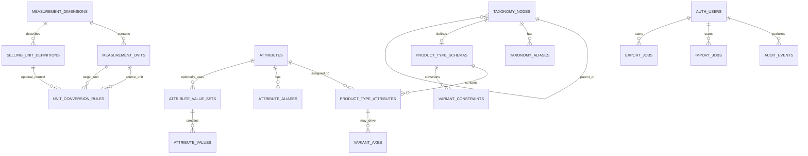

# Unit 10 — Domain Database Schema and ERD

> Status: **Initial schema deployed on 2026-10-15; subsequent domain refinements are merged.** This document remains the conceptual/ERD baseline. Hierarchy/slug rules and Product Type assignment integrity were refined in Unit 20–22; attribute/value/unit/conversion compatibility was refined in Units 24–27. See `context/architecture.md` and `context/progress-tracker.md` for the current contract and open verification items.

## 1. Modeling principles

- Keep the YCP Global Taxonomy independent of merchants and their operational catalog records.
- Preserve the hierarchy **Department → Category → optional Subcategory → Product Type**.
- Treat Product Type as the schema boundary. Attributes are defined globally, then assigned to Product Types through a schema relation.
- Keep attribute definitions, controlled values, physical measurement units, and selling/packaging units separate.
- Model variants as a Product Type schema capability driven by selected attributes, not as a separate operational product inventory.
- Prefer stable UUID primary keys, explicit foreign keys, uniqueness constraints, and archive timestamps over destructive deletion.
- Use `name_ar` as required Arabic display text and `name_en` as optional English display text.
- Use immutable/stable `id` values (UUIDs) for all relational references and foreign keys. Never use a slug or display name as the sole relationship key.
- Use `slug` for readable URLs, navigation, and search; it is not the primary relationship key and may require a controlled rename policy.
- Preserve raw/imported values and source provenance when a value is normalized.
- Do not create a standalone schema-version entity/table in the initial design without an approved use case.

## 2. Proposed ERD

`AUTH_USERS` represents Supabase Auth identities, not a proposed table to duplicate Auth's user store. Audit/import/export entities are later-phase candidates and do not need to be created in the first migration.

## 3. Proposed entities

### 3.1 `taxonomy_nodes`

One row for each global taxonomy node.

Proposed columns:
- `id uuid primary key`
- `parent_id uuid null references taxonomy_nodes(id)`
- `node_type text check in ('department','category','subcategory','product_type')`
- `name_ar text not null`, `name_en text null`
- `slug text not null` (readable URL/search identifier; never the relational key)
- `sort_order integer not null default 0`
- `status text not null default 'active' check in ('active','archived')`
- `created_at timestamptz`, `updated_at timestamptz`, `archived_at timestamptz null`
- `created_by uuid null`, `updated_by uuid null` referencing `auth.users(id)` where appropriate

Constraints/indexes to design:
- Unique active slug policy must be scoped deliberately (global vs siblings); do not assume before review.
- Index `parent_id`, `node_type`, and active status for tree queries.
- Parent-child type rules must enforce the allowed hierarchy. A plain FK cannot enforce all type combinations; use a carefully tested trigger or transactional domain validation.
- Prevent cycles during reparenting in server-side domain logic and database-safe transaction design.
- Archive rather than hard-delete when dependent records exist.

### 3.2 `taxonomy_aliases`

Alternative names/legacy labels for taxonomy nodes.

Proposed columns: `id`, `taxonomy_node_id`, `alias_text`, optional `language_code`, `source_system`, `source_value`, `created_at`.

Use this for synonym search and legacy ERP/import mappings, not to replace canonical `name_ar` / `name_en`. Add uniqueness only after deciding whether alias uniqueness is global, per node, or per source.

### 3.3 `attributes`

Global reusable attribute dictionary.

Proposed columns:
- `id uuid primary key`
- `key text not null unique` (stable machine key)
- `name_ar text not null`, `name_en text null`
- `data_type text check in ('string','number','boolean','enum')`
- `filter_type text` representing current UI concepts where applicable
- `measurement_dimension_id uuid null`
- `value_set_id uuid null` only if the design chooses a single default set; alternatively bind sets through a join table
- `status`, timestamps, actor fields

The current `filter_type` is a UI filter presentation choice, not a substitute for data type or a measurement definition. Keep these concerns distinct. Decide whether `filter_type` should be extensible or constrained to a reviewed enum.

### 3.4 `attribute_aliases`

Alternative labels and source-system names for an attribute. Proposed columns: `id`, `attribute_id`, `alias_text`, `language_code`, `source_system`, `source_value`, `created_at`.

### 3.5 `attribute_value_sets` and `attribute_values`

Represent controlled vocabularies such as colors, materials, brands, sizes, or other enumerated values.

- `attribute_value_sets`: `id`, `key`, `name_ar`, optional `name_en`, optional owning attribute, status and timestamps.
- `attribute_values`: `id`, `value_set_id`, stable `value_key`, `label_ar`, optional `label_en`, optional `raw_value`, status and timestamps.

Do not store numeric measurements as strings in a generic enum set. Preserve raw imported labels when mapping a source value to a controlled value. Confirm whether a set is globally reusable or attribute-specific before finalizing uniqueness constraints.

### 3.6 `product_type_schemas`

One schema record associated one-to-one with a taxonomy node whose `node_type = 'product_type'`.

Proposed columns: `id`, `taxonomy_node_id unique`, `status`, timestamps and actor fields. Do not add a version table in this initial design. Schema evolution policy should be explicit in migration/review documentation.

### 3.7 `product_type_attributes`

Join table assigning global attributes to a Product Type schema.

Proposed columns:
- `id`, `product_type_schema_id`, `attribute_id`
- `is_required boolean`, `is_filterable boolean`
- `display_order integer`, optional `group_key`
- optional `attribute_value_set_id`
- optional validation/configuration JSON only for truly schema-specific settings, with Zod/server-side validation and documented shape
- timestamps and actor fields

Add a unique constraint on (`product_type_schema_id`, `attribute_id`). This relation replaces the current conceptual pattern of storing per-category attribute bindings and `allowed_values` directly inside the category JSON. The export contract must preserve downstream compatibility or explicitly version the output.

### 3.8 `variant_axes` and `variant_constraints`

- `variant_axes` references a Product Type attribute assignment and marks it as a variant-driving axis, with order and optional configuration.
- `variant_constraints` expresses reviewed cross-axis rules, combination restrictions, or axis cardinality constraints.

Variant behavior is schema-driven. This tool must not create Merchant Product or operational Variant records. Avoid duplicating a generic `is_variant` flag across unrelated entities; define one source of truth and derive the UI state from it.

### 3.9 Measurement and selling units

**`measurement_dimensions`**: physical dimension such as length, mass, volume, area, or count.

**`measurement_units`**: unit definitions linked to one dimension, with stable key, Arabic/English names, symbol, conversion-to-base parameters, and active/archive state.

**`unit_conversion_rules`**: explicit conversion between compatible units, including multiplier and optional offset where needed. Do not permit cross-dimension conversions without a reviewed domain rule.

**`selling_unit_definitions`**: commercial/package unit concepts such as piece, pack, box, roll, bag, or pallet, with optional quantity relation to a base selling unit. These are not interchangeable with physical measurement units. A box can contain N pieces; it is not itself a physical dimension like kilogram or meter.

Keep advanced unit relationships in their own phase and validate conversions with decimal-safe arithmetic. Do not use floating-point math for authoritative conversion calculations without an approved precision strategy.

### 3.10 Later-phase operational support tables

Candidates, not part of the initial schema foundation:
- `audit_events`: append-only record of actor, operation, entity/table, entity ID, timestamp, and safe before/after or change metadata. Avoid storing secrets or unnecessary personal data.
- `import_jobs` / `export_jobs`: job status, source/target format, row counts, validation summary, actor, and timestamps. Do not store large files in JSON columns; define storage policy separately.
- Storage bucket/object metadata for taxonomy images, if the project later moves images from `public/categories/`.

## 4. Explicitly excluded entities

Do not create these as part of Taxonomy Builder's taxonomy schema:
- Merchant Product
- operational Variant inventory records
- Merchant Offer
- Branch Listing
- Canonical Product (optional/later, separate decision)
- stock, price, order, payment, or vendor onboarding entities
- a standalone schema-version entity/table without an approved requirement

## 5. Open design decisions before SQL

- Slug uniqueness scope: global, per parent, or separate per node type; also define slug rename and redirect/compatibility behavior if URLs persist externally.
- Whether `attributes.key` is globally unique and immutable after first use.
- Whether attribute value sets are global or attribute-owned.
- Whether measurement dimensions and units seed data are curated by code migrations or editable database records.
- Exact product-type child/hierarchy rules.
- Whether audit history stores field diffs, snapshots, or both, and retention policy.
- Whether one shared global taxonomy is enough or a workspace concept is genuinely needed. Do not introduce multi-tenant tables by assumption.
- Export format compatibility and explicit versioning of the export document (not a schema-version table).

## 6. Review checklist

- [ ] Confirm hierarchy invariants against the YCP domain specification.
- [ ] Confirm attributes are assigned at Product Type, not merely Category.
- [ ] Confirm measurement units are separate from selling/packaging units.
- [ ] Confirm no operational marketplace entities are introduced.
- [ ] Confirm archival and referential-integrity behavior.
- [ ] Approve table names, constraints, and the initial migration boundary before SQL is written.
