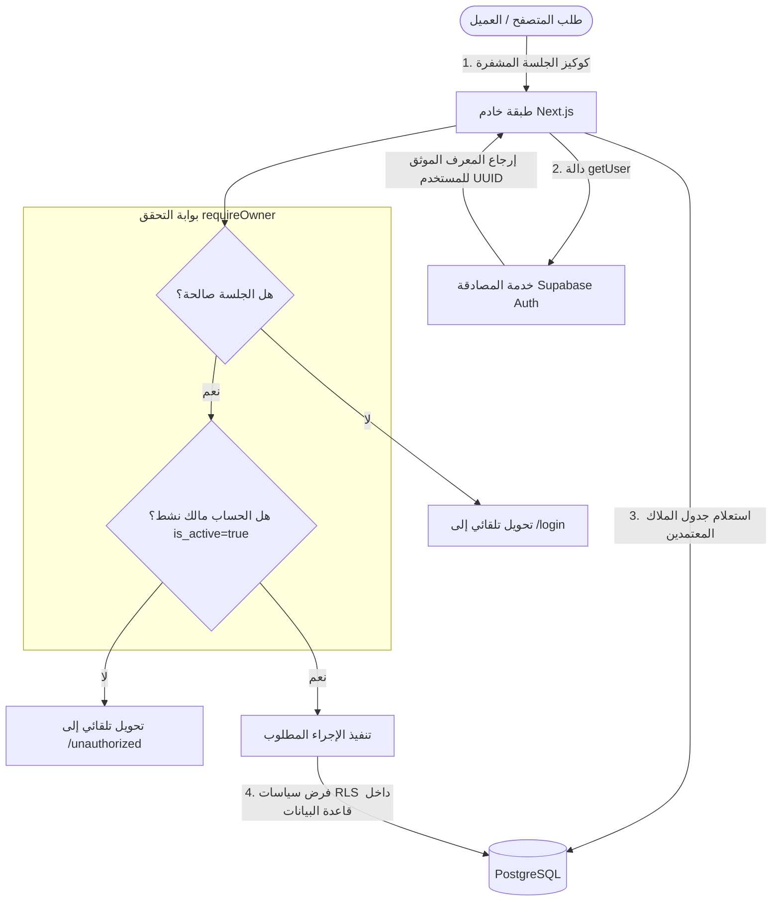

# الأمان، إدارة الجلسات وسياسات أمان السجلات (RLS)

يوضح هذا المستند بالتفصيل الاستراتيجية الأمنية الصارمة المتبعة في **مخطط التصنيفات والكتالوج**، بدءاً من إدارة الجلسات عبر ملفات تعريف الارتباط الآمنة، مروراً ببوابة المالك البرمجية، وانتهاءً بسياسات أمان مستوى السجل (Row-Level Security) في PostgreSQL.



---

## 1. أساسيات المصادقة وإدارة الجلسات (`@supabase/ssr`)

يعتمد النظام على الحزمة الرسمية `@supabase/ssr` لإدارة وتخزين جلسات المستخدمين في كوكيز الخادم (Server Cookies) عبر نمط آمن تماماً.

### أسباب تفضيل كوكيز الخادم على التخزين المحلي (LocalStorage):
1. **الحماية من هجمات XSS و CSRF**: تُحفظ رموز الوصول في كوكيز موسومة بخاصية `SameSite=Lax` و `HttpOnly`، مما يمنع البرمجيات الخبيثة من سرقة الرموز في المتصفح.
2. **التمكين الحقيقي لـ SSR**: تقرأ مكونات الخادم الجلسة مباشرة من ترويسات الطلب الوارد لبناء الصفحة قبل إرسالها للعميل.
3. **تجديد التوكن التلقائي (Auto Token Refresh)**: يتم تجديد الجلسات المنتهية تلقائياً على الخادم دون الحاجة لإعادة توجيه المستخدم أو مقاطعة عمله.

---

## 2. بوابة التحقق من صلاحيات المالك (`requireOwner`)

مجرد امتلاك حساب صالح في نظام Supabase Auth **لا** يمنح المستخدم صلاحية الدخول للأداة. تفرض المنصة بوابة أمان صارمة في الملف `lib/auth/require-owner.ts`:

```typescript
import 'server-only';
import { redirect } from 'next/navigation';
import { createClient } from '@/lib/supabase/server';

export async function requireOwner() {
  const supabase = await createClient();
  const { data: { user }, error } = await supabase.auth.getUser();

  // الخطوة 1: التأكد من وجود جلسة دخول نشطة وموثقة
  if (error || !user) {
    redirect('/login');
  }

  // الخطوة 2: فحص قائمة الملاك المعتمدين في جدول app_authorized_users
  const { data: authorization, error: authError } = await supabase
    .from('app_authorized_users')
    .select('user_id')
    .eq('user_id', user.id)
    .eq('is_active', true)
    .maybeSingle();

  if (authError || !authorization) {
    redirect('/unauthorized');
  }

  return { supabase, user };
}
```

### القواعد الأمنية المطبقة:
- **حزمة `server-only`**: تضمن منع استيراد هذا الملف أو تنفيذه داخل متصفح المستخدم إطلاقاً.
- **استخدام `getUser()` بدلاً من `getSession()`**: يتم الاتصال بخادم مصادقة Supabase للتحقق من سلامة وصلاحية التوكن بشكل موثق، وتجنب الاعتماد على بيانات مفكوكة محلياً قد تكون مزورة.

---

## 3. سياسات أمان مستوى السجل (PostgreSQL RLS)

حتى في حال حاول مهاجم تجاوز واجهة Next.js واستدعاء واجهات Supabase REST مباشرة باستخدام المفتاح العام `anon`، فإن محرك PostgreSQL يرفض وصوله تماماً.

### 3.1 إلغاء الوصول للمجهولين (Revoke Anon Access)
تم سحب كافة الصلاحيات عن دور المستخدمين المجهولين (`anon`) في جميع جداول النظام:

```sql
revoke all on public.app_authorized_users from anon;
revoke all on public.taxonomy_nodes from anon;
revoke all on public.attributes from anon;
revoke all on public.product_type_schemas from anon;
revoke all on public.product_type_attributes from anon;
revoke all on public.measurement_dimensions from anon;
revoke all on public.measurement_units from anon;
revoke all on public.attribute_value_sets from anon;
revoke all on public.attribute_values from anon;
```

### 3.2 سياسات المالك الديناميكية الموحدة
تتحقق كل سياسة من تطابق المستخدم المصادق مع سجل معتمد في جدول `app_authorized_users`:

```sql
-- النمط المطبق على كافة الجداول:
create policy "taxonomy_nodes_owner_select" on public.taxonomy_nodes
  for select to authenticated
  using (
    exists (
      select 1 from public.app_authorized_users a
      where a.user_id = (select auth.uid()) and a.is_active = true
    )
  );

create policy "taxonomy_nodes_owner_insert" on public.taxonomy_nodes
  for insert to authenticated
  with check (
    exists (
      select 1 from public.app_authorized_users a
      where a.user_id = (select auth.uid()) and a.is_active = true
    )
  );

create policy "taxonomy_nodes_owner_update" on public.taxonomy_nodes
  for update to authenticated
  using (
    exists (
      select 1 from public.app_authorized_users a
      where a.user_id = (select auth.uid()) and a.is_active = true
    )
  )
  with check (
    exists (
      select 1 from public.app_authorized_users a
      where a.user_id = (select auth.uid()) and a.is_active = true
    )
  );

create policy "taxonomy_nodes_owner_delete" on public.taxonomy_nodes
  for delete to authenticated
  using (
    exists (
      select 1 from public.app_authorized_users a
      where a.user_id = (select auth.uid()) and a.is_active = true
    )
  );
```

---

## 4. سياسات أمان مستودع الصور (`categories` Storage Bucket)

يحتوي المستودع على جميع الصور التوضيحية للتصنيفات وأنواع المنتجات:
- **القراءة العامة**: متاحة لجميع زوار المتجر عبر شبكة التوزيع السريع (CDN).
- **الرفع والتعديل**: مقيد للمالك فقط عبر سياسة Storage RLS:

```sql
create policy "owner_uploads_category_images"
  on storage.objects for insert to authenticated
  with check (
    bucket_id = 'categories' and
    exists (
      select 1 from public.app_authorized_users
      where user_id = auth.uid() and is_active = true
    )
  );
```
