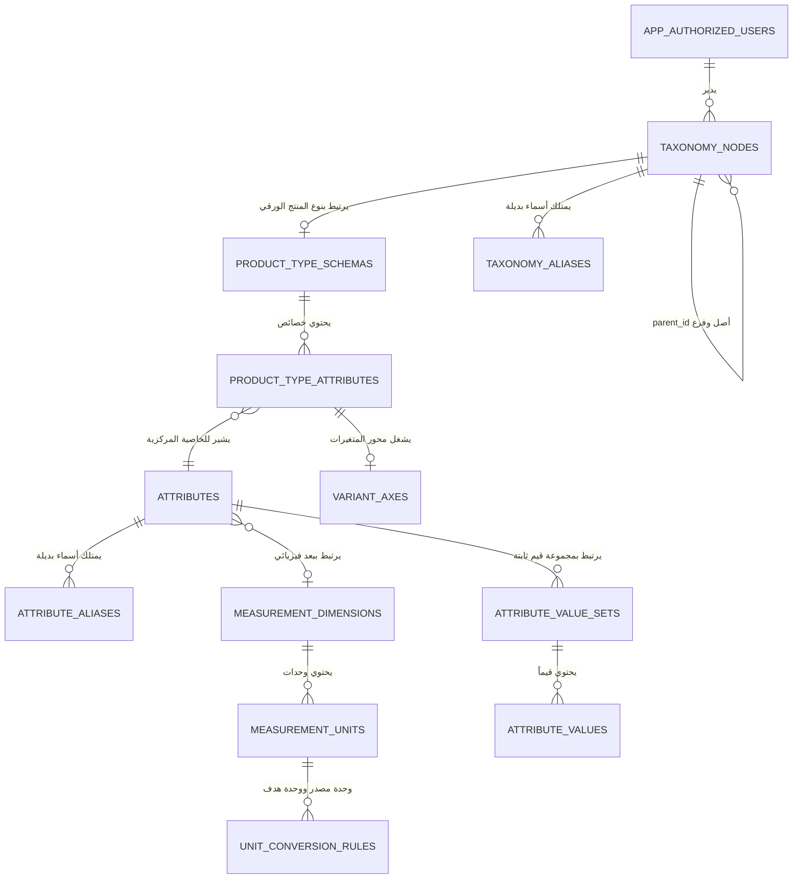

# بنية قاعدة البيانات، العلاقات ودوال الـ RPC

يوفر هذا المستند مرجعاً هندسياً شاملاً لبنية الجداول والعلاقات والقيود الفريدة ودوال المعالجة الذرية (RPC) ونمط لقطات الكتالوج السريعة في قاعدة بيانات Supabase PostgreSQL.



---

## 1. بنية الجداول العلائقية الرئيسية

### 1.1 جدول شجرة التصنيفات (`taxonomy_nodes`)
يمثل جميع مستويات شجرة التصنيفات في المنصة (`department`, `category`, `subcategory`, `product_type`):

```sql
create table public.taxonomy_nodes (
  id uuid primary key default gen_random_uuid(),
  legacy_id text unique,
  parent_id uuid null references public.taxonomy_nodes(id) on delete restrict,
  node_type text not null check (node_type in ('department','category','subcategory','product_type')),
  name_ar text not null check (length(btrim(name_ar)) > 0),
  name_en text null,
  description text null,
  slug text not null check (length(btrim(slug)) > 0),
  image_path text null,
  sort_order integer not null default 0,
  status text not null default 'active' check (status in ('active','archived')),
  source_metadata jsonb not null default '{}'::jsonb,
  created_at timestamptz not null default now(),
  updated_at timestamptz not null default now(),
  archived_at timestamptz null,
  created_by uuid null references auth.users(id) on delete set null,
  updated_by uuid null references auth.users(id) on delete set null
);
```

#### الفهارس والقيود الهندسية:
- `taxonomy_nodes_parent_id_idx`: فهرس سريع لبناء الشجرة واسترجاع الأبناء فورياً.
- `taxonomy_nodes_active_sibling_slug_uq`: يمنع تكرار الروابط (Slugs) بين الإخوة النشطين تحت نفس الأصل.
- **فرادة الرابط عالمياً للتصنيفات النشطة (Global Slug Uniqueness)**: مطبقة عبر الترحيل `20261015204844_global_active_taxonomy_slug_uniqueness.sql` لضمان صحة المسارات البرمجية في محاكي المتجر `/browse/[[...slug]]`.

---

### 1.2 جدول الخصائص المركزية (`attributes`)
القاموس العام الموحد لجميع الخصائص والمواصفات:

```sql
create table public.attributes (
  id uuid primary key default gen_random_uuid(),
  legacy_id text unique,
  key text not null unique check (length(btrim(key)) > 0),
  name_ar text not null check (length(btrim(name_ar)) > 0),
  name_en text null,
  data_type text not null check (data_type in ('string','number','boolean','enum')),
  filter_type text null,
  measurement_dimension_id uuid null references public.measurement_dimensions(id) on delete restrict,
  sort_order integer not null default 0,
  status text not null default 'active' check (status in ('active','archived')),
  source_metadata jsonb not null default '{}'::jsonb,
  created_at timestamptz not null default now(),
  updated_at timestamptz not null default now(),
  archived_at timestamptz null,
  created_by uuid null references auth.users(id) on delete set null,
  updated_by uuid null references auth.users(id) on delete set null
);
```

---

### 1.3 جداول ربط مخططات أنواع المنتجات (`product_type_schemas` & `product_type_attributes`)
تمثل الحد الفاصل الذي ترتبط عنده الخصائص بنوع المنتج النهائي فقط:

```sql
create table public.product_type_schemas (
  id uuid primary key default gen_random_uuid(),
  taxonomy_node_id uuid not null unique references public.taxonomy_nodes(id) on delete restrict,
  status text not null default 'active' check (status in ('active','archived')),
  source_metadata jsonb not null default '{}'::jsonb,
  created_at timestamptz not null default now(),
  updated_at timestamptz not null default now(),
  created_by uuid null references auth.users(id) on delete set null,
  updated_by uuid null references auth.users(id) on delete set null
);

create table public.product_type_attributes (
  id uuid primary key default gen_random_uuid(),
  product_type_schema_id uuid not null references public.product_type_schemas(id) on delete restrict,
  attribute_id uuid not null references public.attributes(id) on delete restrict,
  is_required boolean not null default false,
  is_filterable boolean not null default false,
  display_order integer not null default 0,
  group_key text null,
  configuration jsonb not null default '{}'::jsonb,
  created_at timestamptz not null default now(),
  updated_at timestamptz not null default now(),
  created_by uuid null references auth.users(id) on delete set null,
  updated_by uuid null references auth.users(id) on delete set null,
  unique (product_type_schema_id, attribute_id)
);
```

---

### 1.4 الأبعاد والوحدات الفيزيائية (`measurement_dimensions` & `measurement_units`)
تضبط العلاقات الرياضية الصارمة لوحدات القياس:

```sql
create table public.measurement_dimensions (
  id uuid primary key default gen_random_uuid(),
  key text not null unique,
  name_ar text not null check (length(btrim(name_ar)) > 0),
  name_en text null,
  status text not null default 'active' check (status in ('active','archived')),
  created_at timestamptz not null default now(),
  updated_at timestamptz not null default now()
);

create table public.measurement_units (
  id uuid primary key default gen_random_uuid(),
  dimension_id uuid not null references public.measurement_dimensions(id) on delete restrict,
  key text not null unique,
  name_ar text not null check (length(btrim(name_ar)) > 0),
  name_en text null,
  symbol text null,
  to_base_multiplier numeric(38,18) not null default 1 check (to_base_multiplier > 0),
  to_base_offset numeric(38,18) not null default 0,
  is_base boolean not null default false,
  status text not null default 'active' check (status in ('active','archived')),
  created_at timestamptz not null default now(),
  updated_at timestamptz not null default now()
);

-- قاعدة ثابتة: وحدة أساس نشطة واحدة فقط لكل بعد فيزيائي
create unique index measurement_units_one_base_per_dimension_uq
  on public.measurement_units(dimension_id) where is_base and status = 'active';
```

---

## 2. نمط اللقطات الذرية (Snapshot Pattern) وحل معضلة $N+1$

في أشجار التصنيف الضخمة التي تحتوي على مئات العقد والخصائص، يؤدي استعلام كل عقدة على حدة إلى استهلاك بطيء للشبكة واستنزاف قاعدة البيانات بما يعرف بمشكلة $N+1$.

يعالج النظام هذه المعضلة عبر دوال RPC متطورة مبنية بلغة PL/pgSQL:

### دالة اللقطة السريعة الموحدة `get_catalog_snapshot()`
تقوم بجلب شجرة التصنيف بالكامل ودمج الخصائص المرتبطة بكل نوع منتج ومحاور المتغيرات عبر استعلام ذري واحد عالي السرعة:

```sql
create or replace function public.get_catalog_snapshot()
returns jsonb
language plpgsql
security invoker
as $$
declare
  v_result jsonb;
begin
  select jsonb_build_object(
    'nodes', coalesce((
      select jsonb_agg(
        jsonb_build_object(
          'id', n.id,
          'legacy_id', n.legacy_id,
          'parent_id', n.parent_id,
          'node_type', n.node_type,
          'name_ar', n.name_ar,
          'name_en', n.name_en,
          'description', n.description,
          'slug', n.slug,
          'image_path', n.image_path,
          'sort_order', n.sort_order,
          'attributes', coalesce(attrs.bound_attributes, '[]'::jsonb)
        ) order by n.sort_order, n.name_ar
      )
      from public.taxonomy_nodes n
      left join lateral (
        select jsonb_agg(
          jsonb_build_object(
            'attribute_id', pta.attribute_id,
            'is_required', pta.is_required,
            'is_filterable', pta.is_filterable,
            'display_order', pta.display_order,
            'group', pta.group_key,
            'role', coalesce(pta.configuration->>'role', 'descriptive'),
            'is_variant', exists (select 1 from public.variant_axes va where va.product_type_attribute_id = pta.id),
            'allowed_values', coalesce(pta.configuration->'allowed_values', '[]'::jsonb)
          ) order by pta.display_order
        ) as bound_attributes
        from public.product_type_schemas pts
        join public.product_type_attributes pta on pta.product_type_schema_id = pts.id
        where pts.taxonomy_node_id = n.id and pts.status = 'active'
      ) attrs on true
      where n.status = 'active'
    ), '[]'::jsonb),
    'timestamp', now()
  ) into v_result;

  return v_result;
end;
$$;
```

---

## 3. دوال الـ RPC المعتمدة في النظام

| اسم الدالة | المدخلات | الوظيفة والهدف |
| :--- | :--- | :--- |
| `save_attribute_definition` | `(p_id, p_key, p_name_ar, p_name_en, p_data_type, p_filter_type, p_measurement_dimension_id, p_sort_order, p_aliases)` | التحقق التلقائي من توافق نمط الفلترة، تحديث الأسماء البديلة، والحفظ الذري للخاصية. |
| `save_measurement_unit` | `(p_id, p_dimension_id, p_key, p_name_ar, p_name_en, p_symbol, p_to_base_multiplier, p_to_base_offset, p_make_base)` | إدارة اعتماد وحدات القياس وتبديل وحدة الأساس مع الحفاظ على القواعد الرياضية. |
| `set_measurement_unit_as_base` | `(p_unit_id)` | إعادة حساب معاملات وإزاحة جميع الوحدات الشقيقة نسبةً إلى وحدة الأساس الجديدة برمجياً ($\text{multiplier}' = \frac{1}{\text{multiplier}}$). |
| `replace_taxonomy_and_attribute_snapshots` | `(p_nodes, p_attributes)` | مطابقة ومزامنة شجرة التصنيفات والخصائص دفعة واحدة ذرية مع حماية السجلات من الضياع. |
