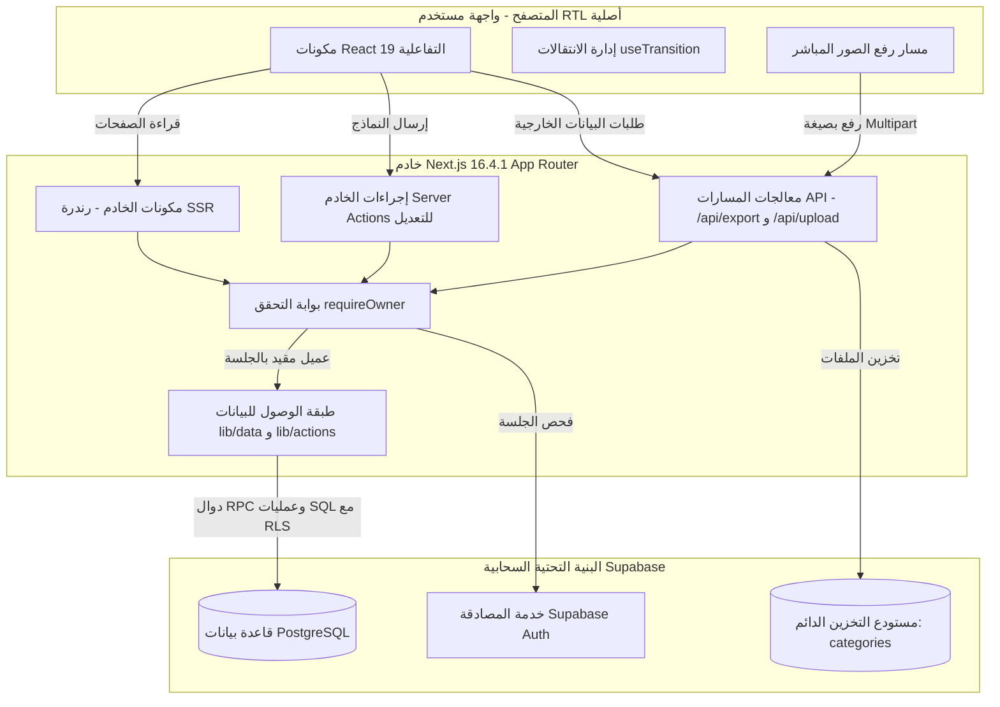

# الهيكل المعماري لـ Next.js وحدود الثقة البرمجية

يوثق هذا المستند بالتفصيل الهيكل المعماري البرمجي لـ **مخطط التصنيفات والكتالوج**، موضحاً دورة حياة الطلبات، واستخدام مكونات الخادم (Server Components)، وإجراءات الخادم (Server Actions)، ومعالجات المسارات (Route Handlers)، وحدود الأمان.



---

## 1. دورة حياة الطلبات واستراتيجية العرض (Rendering)

يعتمد التطبيق بالكامل على **Next.js 16 App Router** مع React 19، مستفيداً إلى أقصى حد من التصيير من جانب الخادم (SSR) مع حصر التفاعل في مكونات الأطراف فقط:

### 1.1 مكونات الخادم الافتراضية (React Server Components)
جميع مسارات التطبيق الرئيسية (`/`, `/tree`, `/taxonomy`, `/browse`, `/categories/[id]`, `/attributes`, `/value-sets`, `/measurements`, `/unit-conversions`) هي مكونات خادم:
- **انعدام شلالات الطلبات (Zero Waterfalls)**: يتم جلب البيانات مباشرة من الخادم عبر استعلامات Supabase آمنة ومربوطة بجلسة المستخدم الحالية.
- **جاهزية كاملة لـ RTL ومحركات البحث**: تُبنى صفحات HTML مبدئياً بالسمات `dir="rtl"` و `lang="ar"` مما يمنع وميض الشاشة أو تشوه المحاذاة أثناء التحميل.
- **تقليل حزم الجافاسكريبت (Zero Client Bundle)**: تبقى جميع مكتبات الفحص والتحقق الضخمة ومخططات Zod وقواعد التحويل الرياضية على الخادم دون إرسالها لمتصفح المستخدم.

### 1.2 مكونات العميل التفاعلية المحصورة (Client Leaves)
يتم استخدام الوسم `'use client'` في الواجهات التفاعلية فقط:
- `TreeManagementClient`: إدارة طي وتوسيع الشجرة ووضع التركيز والعزل (Focus Mode).
- `QuickEditDrawer`: درج سحب سريع للتعديلات الفورية السريعة.
- `CategoryDetailClient`: ربط الخصائص وتحديد أدوارها ورفع الصور الخاصة بنوع المنتج.
- `SpotlightPalette`: لوحة البحث السريع المتقدمة مع اختصارات لوحة المفاتيح (`Cmd+K`).
- `MeasurementCenterManager`, `ValueSetManager`, `AttributeDefinitionManager`: مدراء نماذج ومراكز التعريفات المركزية.

---

## 2. إدارة التعديلات عبر إجراءات الخادم (Server Actions)

تتم جميع عمليات الإدخال والتعديل والحذف عبر Next.js **Server Actions** بطريقة موثوقة ونمطية:

```typescript
'use server';

import { revalidatePath } from 'next/cache';
import { requireOwner } from '@/lib/auth/require-owner';
import { CategorySchema } from '@/lib/types/category';
import type { ActionResult } from '@/lib/types/action-result';

export async function saveCategoryAction(input: unknown): Promise<ActionResult> {
  // 1. التحقق الإلزامي من جلسة المالك المعتمد
  const { supabase, user } = await requireOwner();

  // 2. التحقق الصارم من مدخلات البيانات عبر Zod
  const parsed = CategorySchema.safeParse(input);
  if (!parsed.success) {
    return { success: false, error: parsed.error.issues[0]?.message };
  }

  // 3. التنفيذ في قاعدة بيانات Supabase تحت حماية سياسات RLS
  // ...
  
  // 4. تحديث الكاش وإعادة بناء المسارات المتأثرة فوراً
  revalidatePath('/tree');
  revalidatePath('/taxonomy');
  revalidatePath('/browse', 'layout');

  return { success: true, data: null };
}
```

### مزايا هذا النمط المعماري:
1. **الأمان النوعي (Type Safety)**: تكامل واستنتاج تلقائي للأنواع من قاعدة البيانات وحتى واجهة المستخدم عبر TypeScript.
2. **التحسين التدريجي (Progressive Enhancement)**: سلاسة الاستجابة أثناء الحفظ والانتظار بالاعتماد على خطاف `useTransition()` في React 19.
3. **تحديث الكاش الفوري (Revalidation)**: إلغاء الكاش بدقة في جميع المسارات ذات الصلة لضمان عرض أحدث البيانات بمجرد اكتمال العملية.

---

## 3. حدود الثقة والأمان الصارم

يفرض النظام قواعد هندسية صارمة لا تقبل الاستثناء:

1. **انعدام الصلاحيات في العميل**: لا يمكن لمتصفح المستخدم مطلقاً الحصول على مفتاح الخدمة الإداري (Service Role). جميع العمليات مقيدة بسياسات أمان السجلات (RLS).
2. **استنتاج الهوية من الجلسة الموثقة**: يستخرج الخادم هوية المستخدم حصراً من ملفات تعريف الارتباط المشفرة (HTTP-Only Cookie). أي معرّف مستخدم يتم إرساله داخل جسم الطلب (Body) يتم تجاهله تماماً.
3. **التحقق المزدوج من القواعد الهندسية**:
   - **الطبقة الأولى (التطبيق / Zod)**: استجابة فورية للأخطاء في بيئة TypeScript قبل إرسال الطلب لقاعدة البيانات.
   - **الطبقة الثانية (قاعدة بيانات PostgreSQL)**: مشغلات (Triggers) وقيود فريدة تمنع خرق قواعد البيانات تحت أي ظرف.
4. **التخزين المشترك الحقيقي**: تم التخلص تماماً من ملفات JSON المحلية؛ قاعدة بيانات PostgreSQL هي المصدر الوحيد الحي للبيانات، ويُحظر تماماً نظام الكتابة المزدوجة (Dual-write).
