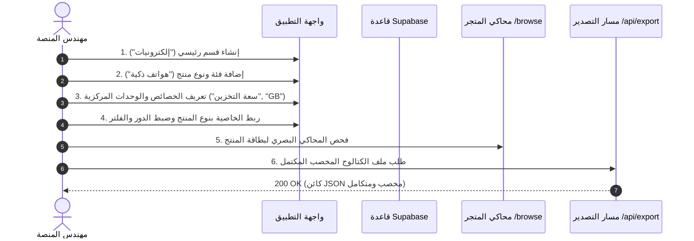

# البداية السريعة ودليل التشغيل الأول

يأخذك هذا الدليل في جولة عملية شاملة خطوة بخطوة للتعرف على دورة العمل الكاملة لبناء وهندسة الكتالوج وتصديره.



---

## 1. تسجيل الدخول والتحقق من الصلاحيات

1. افتح الرابط `http://localhost:3000/login`.
2. أدخل بريدك الإلكتروني المعتمد وكلمة المرور المسجلة.
3. يقوم النظام تلقائياً بالتأكد من:
   - صحة جلسة الكوكيز من Supabase Auth.
   - وجود معرّف المستخدم (UUID) ضمن قائمة الملاك في جدول `app_authorized_users` مع حالة نشطة `is_active = true`.
4. بعد نجاح المصادقة، يتم توجيهك مباشرة إلى لوحة القيادة المركزية في `/`.

---

## 2. بناء شجرة التصنيفات

انتقل إلى صفحة إدارة الشجرة (`/tree`) أو جدول التصنيفات (`/taxonomy`):

### الخطوة 2.1: إضافة قسم رئيسي (Department)
1. انقر على زر **إضافة قسم رئيسي**.
2. اكتب الاسم العربي (مثال: `الأجهزة الإلكترونية`) والاسم الإنجليزي (`Consumer Electronics`).
3. يولد النظام تلقائياً مفتاح الرابط الفريد (Slug) المناسب مثل `consumer-electronics`.
4. انقر على **حفظ**. يظهر القسم الجديد في قمة شجرة التصنيفات.

### الخطوة 2.2: إضافة فئات وأنواع منتجات فرعية
1. مرر مؤشر الفأرة فوق القسم المنشأ وانقر على علامة **+**.
2. حدد نوع العقدة المناسب:
   - أسفل القسم الرئيسي، يمكنك إضافة **تصنيف (Category)** مثل `الهواتف المحمولة`.
   - أسفل التصنيف، يمكنك إضافة **تصنيف فرعي (Subcategory)** أو **نوع منتج (Product Type)** نهائي مثل `هواتف ذكية`.
3. لاحظ أن العقد الورقية (`Product Type`) تحمل شارة تمييز خاصة توضح أنها العقد المخولة بالارتباط مع الخصائص.

---

## 3. إعداد مراكز التعريفات المركزية العامة

قبل ربط الخصائص، يتم إعداد المعايير العامة في مراكز التعريفات المركزية (`/definitions`):

### الخطوة 3.1: إنشاء بُعد فيزيائي ووحدة أساس (`/measurements`)
1. انتقل إلى **مركز الأبعاد والوحدات** (`/measurements`).
2. أضف بعداً فيزيائياً:
   - الاسم بالعربية: `سعة الذاكرة الرقمية`.
   - الاسم بالإنجليزية: `Digital Storage Capacity`.
   - المفتاح الثابت: اتركه فارغاً ليتم توليده تلقائياً `digital_storage_capacity`.
3. أضف الوحدات الفيزيائية التابعة:
   - **بايت (Byte)**: الرمز `B`، اجعلها وحدة الأساس ($\text{multiplier}=1, \text{offset}=0$).
   - **ميجابايت (MB)**: المعامل $1048576$.
   - **جيجابايت (GB)**: المعامل $1073741824$.

### الخطوة 3.2: إنشاء مجموعة قيم محددة (`/value-sets`)
1. انتقل إلى **مركز القيم** (`/value-sets`).
2. أنشئ مجموعة قيم:
   - الاسم: `ألوان الأجهزة`.
   - المفتاح: يُولد تلقائياً كـ `device_colors`.
3. أضف القيم المندرجة تحتها:
   - `أسود فلكي` (المفتاح: `space_black`، القيمة الخام: `#1C1C1E`).
   - `فضي ناصع` (المفتاح: `silver`، القيمة الخام: `#E2E2E2`).

### الخطوة 3.3: تعريف الخصائص المركزية (`/attributes`)
1. انتقل إلى **مركز الخصائص** (`/attributes`).
2. أنشئ خاصية مركزية:
   - الاسم بالعربية: `سعة التخزين الداخلي`.
   - نوع البيانات: `number`.
   - نمط الفلترة: `button_group`.
   - البعد الفيزيائي: اختر `سعة الذاكرة الرقمية`.

---

## 4. ربط وتخصيص الخصائص بنوع المنتج (`/categories/[id]`)

1. ادخل على صفحة تفاصيل العقدة لنوع المنتج `هواتف ذكية` عبر الرابط `/categories/[id]`.
2. في قسم **خصائص نوع المنتج**، انقر على **ربط خاصية**.
3. اختر خاصية `سعة التخزين الداخلي`.
4. حدد خيارات الاستخدام:
   - **الدور**: `variant` (محور متغير لتوليد المنتجات القابلة للبيع).
   - **إلزامي**: `نعم`.
   - **قابل للفلترة**: `نعم`.
   - **الوحدة المتوافقة**: اختر `GB`.
   - **القيم المسموحة**: أدخل `128, 256, 512, 1024`.
5. انقر على **حفظ التغييرات**.

---

## 5. محاكاة واجهة المتجر للمتسوق (`/browse`)

1. اضغط على زر **تصفح المتجر** أو توجه إلى الرابط `/browse`.
2. تصفح عبر البطاقات الدائرية الجذابة:
   `الأجهزة الإلكترونية` $\leftarrow$ `الهواتف المحمولة` $\leftarrow$ `هواتف ذكية`.
3. عند الوصول لنوع المنتج، تظهر لك **بطاقة مواصفات المنتج (Product Blueprint)**:
   - خصائص الهوية (الماركة والموديل) موسومة بدرع التمييز.
   - محاور المتغيرات (السعة واللون) بارزة لتوليد خيارات الشراء.
   - المواصفات الفنية والتجارية مصنفة في مجموعات أنيقة وواضحة.

---

## 6. تصدير الكتالوج إلى الإنتاج (`/api/export`)

أرسل طلب استعلام HTTP GET موثق لتصدير شجرة الكتالوج المخصبة كاملة:

```bash
curl -X GET "http://localhost:3000/api/export?download=true" \
  -H "Cookie: sb-access-token=..." \
  -o catalog-taxonomy-enriched.json
```

يحتوي ملف JSON الناتج على مسارات كاملة جاهزة، وحساب العمق الدقيق، ومخططات الخصائص المفككة المكتملة لتغذية فهارس البحث والتطبيقات الإنتاجية فوراً.
