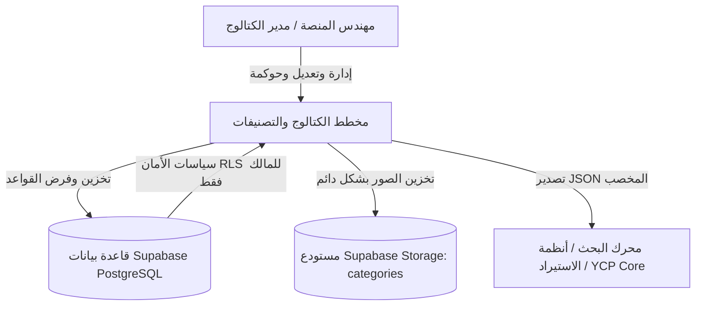

# مخطط التصنيفات والكتالوج (Taxonomy & Catalog Planner) — الدليل الشامل

يُعد **مخطط التصنيفات والكتالوج** أداة متقدمة من الدرجة المؤسسية (Enterprise-Grade) متخصصة في النمذجة البصرية والحوكمة الهندسية لشجرة تصنيفات التجارة الإلكترونية، وقواميس الخصائص، ومخططات أنواع المنتجات (Product Types)، وأنظمة القياس والوحدات الفيزيائية لمنصة **YCP (Yemen Commerce Platform)**.

---

## 1. الملخص التنفيذي والرسالة الاستراتيجية

في منصات التجارة الإلكترونية متعددة التجار والضخمة، يؤدي غياب الحوكمة الصارمة للكتالوج إلى عواقب وخيمة على تجربة المستخدم ونسب التحويل وسرعة إدراج منتجات التجار، وتتمثل أبرز هذه التحديات في:

1. **فوضى الشجرة الهرمية**: تداخل التصنيفات، التكرار، أو نشوء حلقات دائرية غير متناهية (Circular Loops).
2. **تشتت الخصائص والمواصفات**: تكرار الخاصية الواحدة بأسماء وصيغ متباينة (مثل: `اللون`, `Color`, `colour_code`) مما يُفشل التصفية والفلاتر التجميعية في واجهة المتجر.
3. **غياب المعايير الفيزيائية الرياضية**: خلط وحدات القياس (مثل `واط` مع `كيلو واط`) دون معادلات تحويل رياضية واضحة للوحدة الأساسية.
4. **الانفجار التبادلي لخيارات المنتجات (Matrix Explosion)**: تحويل سمات وصفية عامة عشوائياً إلى محاور متغيرات (Variants) مما يثقل قواعد البيانات بآلاف السجلات غير القابلة للبيع.

يقدم **مخطط الكتالوج** الحل الجذري لهذه المشكلات قبل وصول أي بيانات إلى قواعد البيانات التشغيلية، حيث يعمل بمثابة **المصدر المعتمد الوحيد (Single Source of Truth)** لهندسة التصنيف ومخططات المنتجات.

---

## 2. الركائز المعمارية الأساسية

### 2.1 الهيكل الهرمي الصارم رباعي المستويات
يفرض النظام رياضياً وقاعدياً تسلسلاً هرمياً ثابتاً لا يمكن خرقه:
$$\text{القسم الرئيسي (Department)} \longrightarrow \text{التصنيف (Category)} \longrightarrow \text{التصنيف الفرعي (Subcategory - اختياري)} \longrightarrow \text{نوع المنتج (Product Type)}$$

- **حدود الخصائص**: نوع المنتج (`Product Type`) هو العقدة الورقية والوحيدة المخولة باحتواء مخططات الخصائص. العقد العليا تنظيمية وملاحية فقط.
- **منع الحلقات الدائرية**: تعتمد شجرة التصنيف على خوارزمية استبعاد التفرع السفلي (*Subtree Disqualification Algorithm*) لمنع اختيار أي عنصر كأصل لنفسه أو لأحد فروعه.

### 2.2 التعريفات المركزية والحوكمة الدلالية
الخصائص، ومجموعات القيم (Enum Value Sets)، والأبعاد الفيزيائية، ووحدات القياس تُعرّف في مراكز حوكمة مركزية مستقلة. وعند ربطها بنوع المنتج، فإنها ترتبط كمرجع:
- أي تحديث في المركز العام ينعكس فوراً دون تكرار البيانات.
- الحماية من الحذف: لا يمكن حذف أي تعريف قيد الاستخدام الفعلي، بل تتاح له دورة أرشفة آمنة للحفاظ على التكامل التاريخي.

### 2.3 نموذج أمان المالك الصارم (Owner-Only Security)
نظراً لأن شجرة التصنيف والخصائص تمثل البنية التحتية للمنصة بأكملها، فإن الصلاحيات تقتصر على المالك المعتمد فقط:
- **المصادقة**: مبنية عبر جلسات كوكيز آمنة من Supabase Auth (`@supabase/ssr`).
- **قائمة الملاك المعتمدين**: التحقق البرمجي الإلزامي عبر جدول `app_authorized_users` بشرط `is_active = true`.
- **أمان مستوى السجل (RLS)**: مفروض مباشرة داخل محرك PostgreSQL لجميع الجداول والدوال البرمجية.

### 2.4 محرك التصدير عالي الأداء والمسارات المحسوبة
تحتاج محركات البحث والواجهات الخارجية إلى كتالوج مسطح ومخصب. يوفر المسار `/api/export` لقطة ذرية موحدة تتضمن:
- المسارات النصية المحسوبة مسبقاً (Materialized Breadcrumb Paths) مثل: `"الكهرباء والإنارة / الإضاءة / لمبات"`.
- العمق الدقيق للعقدة داخل الشجرة.
- الخصائص المفككة والمحلولة مع أدوارها، وأنماط الفلترة، ووحداتها وقيمها المسموحة.

---

## 3. المعايير التقنية المعتمدة في المشروع

| الطبقة التقنية | التقنية المستخدمة | الإصدار والمواصفات |
| :--- | :--- | :--- |
| **إطار العمل** | Next.js App Router | `16.4.1` (Turbopack, Server Actions, Route Handlers) |
| **مكتبة الواجهة** | React & React DOM | `19.3.0` |
| **لغة البرمجة** | TypeScript | `^6.0.3` (Strict mode) |
| **التنسيق والأنماط** | Tailwind CSS | `4.x` (دعم كامل للعربية RTL عبر Logical Properties) |
| **قاعدة البيانات** | PostgreSQL | سحابة Supabase (Triggers, Foreign Keys, RLS, RPCs) |
| **إدارة الجلسات** | `@supabase/ssr` & `@supabase/supabase-js` | `0.12.7` / `2.117.3` |
| **التحقق من البيانات** | Zod | `4.6.5` |
| **لوحة الأوامر السريعة** | cmdk | `1.1.1` |
| **الخطوط والطباعة** | Google Fonts | IBM Plex Sans Arabic للأصل العربي و Inter للإنجليزي |

---

## 4. نطاق النظام وحدود المسؤولية

### ما يقع داخل نطاق النظام:
- نمذجة وهندسة وحوكمة شجرة التصنيفات والكتالوج العام.
- القاموس المركزي للخصائص، ووحدات القياس، ومجموعات القيم الثابتة.
- محاكي واجهة المتجر للمتسوق (`/browse`) للتحقق البصري من سلاسة التصفح والفلاتر.
- مسار التصدير البرمجي المخصب لتغذية أنظمة الإنتاج ومحركات البحث.

### ما يقع قطعاً خارج نطاق النظام:
- **ليس** متجراً تشغيلياً مباشراً (لا توجد سلة شراء، أو دفع، أو بوابات مالية).
- **ليس** نظاماً لإدارة المخزون والمستودعات (WMS).
- **ليس** بوابة لإدارة التجار أو تسعير المنتجات أو العروض التنافسية.
- **ليس** تطبيقاً متعدد المستأجرين (SaaS) — الحوكمة مقتصرة على مالك المنصة المعتمد فقط.
