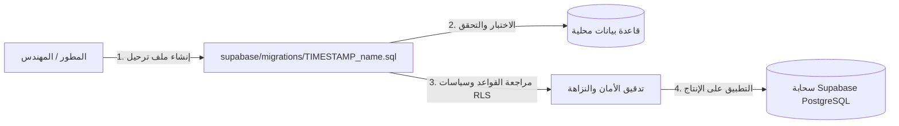

# إدارة ترحيل قواعد البيانات (Migrations) ودورة حياة Supabase

يوفر هذا المستند دليلاً هندسياً شاملاً لكيفية إدارة وكتابة ونشر ملفات ترحيل وتحديث قواعد بيانات PostgreSQL في مشروع **مخطط التصنيفات والكتالوج** باستخدام أداة Supabase CLI ونظام الترقيم الزمني.



---

## 1. الفلسفة والقواعد المتبعة في الترحيل

1. **الترحيل التراكمي غير الهدام (Additive & Non-destructive)**: يجب أن تكون كافة التعديلات تراكمية وآمنة. يُحظر تماماً تنفيذ أوامر الحذف الجماعي `DROP TABLE` أو إعادة كتابة البيانات النشطة في الكتالوج.
2. **الترقيم الزمني الحتمي**: تُحفظ جميع ملفات الترحيل في المجلد `supabase/migrations/` مسبوقة بطابع زمني بصيغة UTC (`YYYYMMDDHHMMSS_description.sql`).
3. **منع إعادة تهيئة البيانات (No Reseeding)**: يُمنع مسح أو إعادة تهيئة قاعدة البيانات الحية كجزء من تطوير الميزات العادية للحفاظ على السجلات الحالية.
4. **التنفيذ الآمن المتكرر (Idempotency)**: استخدام صيغ التحقق مثل `IF EXISTS` و `IF NOT EXISTS` والقيود المنطقية حتى لا يؤدي تكرار تشغيل الملف إلى حدوث أخطاء أو تشويه للجداول.

---

## 2. السجل الزمني الكامل لملفات الترحيل

| الرمز الزمني | اسم الملف | الهدف والتغييرات الجوهرية |
| :--- | :--- | :--- |
| `20261015175117` | `taxonomy_core_tables.sql` | إنشاء الجداول الأساسية: الملاك المعتمدين، شجرة التصنيفات، الخصائص، ومخططات أنواع المنتجات. |
| `20261015175142` | `taxonomy_supporting_tables_and_rls.sql` | إنشاء جداول الأسماء البديلة، مجموعات القيم، الأبعاد والوحدات الفيزيائية، وقواعد التحويل مع سياسات RLS. |
| `20261015175318` | `index_foreign_keys.sql` | إضافة فهارس تغطية لكافة المفاتيح الأجنبية لضمان سرعة الاستعلامات ومنع القفل المتسلسل. |
| `20261015182130` | `snapshot_repository_rpc_functions.sql` | دوال PL/pgSQL لقراءة وكتابة لقطة الكتالوج الشاملة بشكل ذري. |
| `20261015182602` | `atomic_catalog_snapshot_rpc.sql` | دالة `get_catalog_snapshot()` لجلب الشجرة والخصائص المرتبطة في طلب واحد لحل معضلة $N+1$. |
| `20261015191025` | `categories_storage_bucket_and_owner_policies.sql` | إنشاء حاوية التخزين السحابي `categories` وضبط صلاحيات القراءة العامة والرفع للمالك. |
| `20261015204655` | `enforce_taxonomy_placement_rules.sql` | مشغلات قواعد بيانات مؤجلة (Deferred Triggers) لفرض التدرج الهرمي الرباعي ومنع التجاوز. |
| `20261015204746` | `enforce_taxonomy_placement_and_product_type_schema.sql` | قصر ربط المخططات والمواصفات على نوع المنتج الورقي فقط (`product_type`). |
| `20261015204844` | `global_active_taxonomy_slug_uniqueness.sql` | فرض فرادة روابط التصنيفات النشطة عالمياً لضمان دقة مسارات التصفح في `/browse`. |
| `20261016000004` | `product_type_attribute_editor.sql` | دالة الـ RPC لحفظ وتحديث خصائص نوع المنتج ومحاور المتغيرات ذرياً في معاملة واحدة. |
| `20261016100000` | `taxonomy_node_description.sql` | إضافة حقل الوصف النصي `description` إلى جدول التصنيفات. |
| `20261016120000` | `central_attribute_definition_integrity.sql` | دالة `save_attribute_definition` مع فحص توافق الفلاتر ومنع تكرار الأسماء البديلة. |
| `20261016173835` | `value_unit_conversion_integrity.sql` | ربط قواعد التحويل بوحدات البيع التجارية. |
| `20261016174003` | `measurement_unit_workflows.sql` | دوال `save_measurement_unit` و `set_measurement_unit_as_base` لإعادة حساب المعاملات تلقائياً. |
| `20261016175400` | `rebase_archived_measurement_units.sql` | معالجة حالات الأرشفة الآمنة أثناء تبديل وحدات الأساس. |
| `20261016175606` | `measurement_dimension_base_invariant.sql` | فرض شرط وجود وحدة أساس نشطة واحدة على الأقل لكل بعد فيزيائي. |

---

## 3. آلية إنشاء وتطبيق ترحيل جديد

### 3.1 إنشاء ملف الترحيل

عبر أداة Supabase CLI:

```bash
supabase migration new add_feature_xyz
```

يقوم هذا الأمر بإنشاء ملف مؤرخ زمنياً داخل المجلد `supabase/migrations/`.

### 3.2 كتابة أوامر الـ SQL الآمنة

تأكد دائماً من تفعيل سياسات الأمان RLS لكل جدول جديد:

```sql
-- مثال: إضافة حقل تقني إضافي
alter table public.attributes
  add column if not exists search_boost numeric(3,2) not null default 1.0;

-- التأكد من استمرار تفعيل سياسات أمان السجلات
alter table public.attributes enable row level security;
```

### 3.3 تطبيق ملفات الترحيل على السحابة

لنشر التغييرات على مشروع Supabase:

```bash
# ربط المشروع
supabase link --project-ref your-project-id

# دفع الترحيلات الجديدة المعلقة
supabase db push
```
