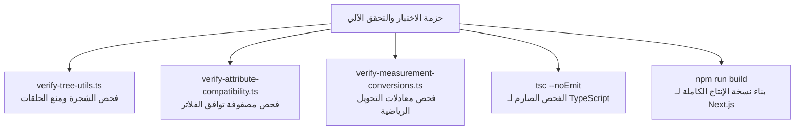

# سكريبتات الفحص والتحقق من النزاهة الهندسية

يوضح هذا المستند بروتوكولات الفحص والتحقق الآلي، واختبار القواعد الهندسية للشجرة، وسكربتات التشخيص البرمجية لضمان عدم حدوث أي تراجع أو خلل في الكتالوج.



---

## 1. سكربتات التحقق الآلية المستقلة

يحتوي المستودع على سكربتات فحص مبنية بـ TypeScript في مجلد `scripts/`. تعمل هذه السكربتات مباشرة في بيئة Node.js عبر أداة `npx tsx` لاختبار الخوارزميات بشكل معزول تماماً عن واجهات المستخدم:

### 1.1 `scripts/verify-tree-utils.ts`
يختبر بناء شجرة التصنيفات، واستخراج سلسلة الآباء، وخوارزميات منع الحلقات الدائرية:
- **حساب العمق**: التحقق من أن العقد الجذرية تأخذ العمق 0 ويتزايد العمق للأبناء تسلسلياً.
- **منع الحلقات الدائرية**: التحقق من أن دالة `getForbiddenParentIds` تحظر العقدة وأصلها وكافة فروعها بدقة.
- **قواعد التموضع الهرمي**: التأكد من أن `validateNodePlacement` تحظر العلاقات الشاذة (مثل وضع تصنيف فرعي تحت قسم رئيسي مباشرة).

طريقة التشغيل:
```bash
npx tsx scripts/verify-tree-utils.ts
```

### 1.2 `scripts/verify-attribute-compatibility.ts`
يختبر مصفوفة التوافق الصارمة بين أنواع البيانات وأنماط الفلاتر البصرية:
- يضمن أن نوع `number` يقبل نمط `range` ويرفض `color_swatch`.
- يضمن أن نوع `enum` يقبل `color_swatch` و `button_group`.
- يتحقق من الكشف السليم عن السجلات القديمة غير المتوافقة دون إيقاف الخادم أو رمي أخطاء غير معالجة.

طريقة التشغيل:
```bash
npx tsx scripts/verify-attribute-compatibility.ts
```

### 1.3 `scripts/verify-measurement-conversions.ts`
يختبر سلامة المعادلات والتحويلات الفيزيائية الرياضية:
- يتحقق من دقة معادلة التحويل الخطي إلى الأساس: $\text{Value}_{\text{base}} = \text{Value} \times m + o$.
- يتحقق من دقة المعادلة العكسية للوحدات: $\text{Value} = \frac{\text{Value}_{\text{base}} - o}{m}$.
- يفحص دقة التقريب للأعداد الكسرية حتى 18 خانة عشرية.

طريقة التشغيل:
```bash
npx tsx scripts/verify-measurement-conversions.ts
```

---

## 2. التحليل الساكن وفحص الأنظمة البرمجية (Type Checking)

تم ضبط مترجم TypeScript على وضع التدقيق الصارم (Strict Mode). للتحقق من خلو جميع الإجراءات ومكونات الخادم والواجهات من أي خطأ في الأنواع:

```bash
npx tsc --noEmit
```

### القواعد المفروضة:
- منع استخدام النوع الضمني المجهول `any`.
- الفحص الصارم للقيم المعدومة أو الفارغة (`null` و `undefined`) في كافة المفاتيح الأجنبية والحقول الاختيارية.
- المزامنة التامة بين مخططات Zod وأنواع TypeScript وقواعد البيانات.

---

## 3. التحقق من اكتمال بناء الإنتاج (Production Build)

يمثل اختبار البناء الشامل الاختبار النهائي لضمان جاهزية المنصة للنشر على Vercel أو الخوادم السحابية:

```bash
npm run build
```

تؤكد النتيجة الناجحة سلامة جميع معالجات المسارات والمكونات ومسار التصدير:
```text
✓ Compiled successfully
  Collecting page data ...
✓ Generating static pages (8/8)
  Finalizing page optimization ...

Route (app)
├ ƒ /
├ ƒ /attributes
├ ƒ /browse/[[...slug]]
├ ƒ /categories/[id]
├ ○ /data-types
├ ○ /definitions
├ ƒ /measurements
├ ƒ /taxonomy
├ ƒ /tree
├ ƒ /unit-conversions
└ ƒ /value-sets
```
