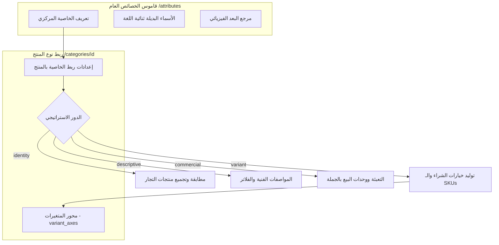

# قاموس الخصائص المركزي والأدوار الاستراتيجية الأربعة

يوثق هذا المستند بنية قاموس الخصائص المركزي، وأنواع البيانات الأولية، وأنماط الفلترة المتوافقة، بالإضافة إلى **الأدوار الاستراتيجية الأربعة للخصائص** المعتمدة في أنظمة إدارة معلومات المنتجات (PIM).



---

## 1. الهيكل المعماري للخاصية المركزية

تُعرّف الخصائص مرة واحدة في **مركز الخصائص** (`/attributes`) ويُعاد استخدامها عبر مختلف أنواع المنتجات:

### الحقول الأساسية

- `key`: المفتاح البرمجي الثابت بصيغة `snake_case` (مثل `screen_size`, `color_temp`). يُنشأ تلقائياً عند تركه فارغاً.
- `name_ar`: التسمية العربية الأساسية (مثل `حجم الشاشة`).
- `name_en`: التسمية الإنجليزية المرجعية (مثل `Screen Size`).
- `data_type`: نوع البيانات الأولي (`string`, `number`, `boolean`, `enum`).
- `filter_type`: مظهر ونمط الفلتر في المتجر (`range`, `checkbox`, `select`, `toggle`, `color_swatch`, `button_group`).
- `measurement_dimension_id`: اختياري للخصائص الرقمية للربط ببعد فيزيائي محدد (مثل ربط `screen_size` ببعد الطول).

---

## 2. الأدوار الاستراتيجية الأربعة للخصائص (Attribute Roles)

عند ربط خاصية بنوع منتج (`product_type`)، يجب تحديد **دور استراتيجي واحد** يحدد كيفية تعامل محركات البحث والتجار والمتجر مع هذه الخاصية:

| الدور | الاسم بالعربية | المسؤولية الأساسية | هل يولد متغيرات (SKU)؟ | الاستخدام في الفلاتر | مثال عملي |
| :--- | :--- | :--- | :---: | :---: | :--- |
| **`identity`** | هوية المنتج | تمييز الموديل بدقة وتجميع عروض التجار المتنافسين تحت بطاقة منتج موحدة | ❌ لا | ⚠️ نادر | `الموديل`, `رقم القطعة (MPN)`, `الماركة / العلامة التجارية` |
| **`variant`** | محور تباين | خيارات يحددها المشتري في صفحة المنتج؛ تولد خيارات شراء وسجلات SKU مستقلة | ✅ **نعم** | ✅ نعم | `اللون`, `المقاس`, `سعة الذاكرة الداخلية` |
| **`descriptive`** | مواصفة فنية | تفاصيل تقنية ووصفية شاملة لتمكين المشتري من المقارنة واتخاذ القرار | ❌ لا | ✅ نعم | `دقة الشاشة`, `نوع المعالج`, `إصدار البلوتوث` |
| **`commercial`** | تجاري ولوجستي | تفاصيل التعبئة والشحن والكميات الدنيا للطلب ووحدات الجملة | ❌ لا | ⚠️ حسب السياق | `وحدة البيع للتاجر`, `الكمية في الصندوق`, `بلد المنشأ` |

---

## 3. الشرح التفصيلي لكل دور

### 3.1 دور الهوية (`identity`)

يعتبر عصب كفاءة المنصات متعددة التجار؛ فعندما يقوم 10 تجار برفع نفس المنتج (مثل *هاتف iPhone 15 Pro Max*)، يعتمد النظام على خصائص الهوية (`brand`, `model_number`) لدمج العروض في صفحة منتج موحدة، مما يمنع التكرار المزعج للمشترين.

- **قاعدة ثابتة**: لا يمكن لخاصية الهوية أن تكون محور متغيرات (`is_variant = false`).

### 3.2 دور التباين والمتغيرات (`variant`)

يمكّن المشتري من اختيار التشكيلة المناسبة داخل نفس الصفحة (مثل اختيار هاتف بسعة *256GB* ولون *تيتانيوم طبيعي*).

- **المزامنة التلقائية**: اختيار هذا الدور يؤدي تلقائياً إلى إنشاء سجل مرتبط في جدول `public.variant_axes`.
- **حساب مصفوفة الـ SKUs**: يمثل عدد المنتجات الفرعية حاصل الضرب الديكارتي لقيم محاور التباين:
  $$\text{عدد الـ SKUs} = \prod_{i=1}^{n} |\text{القيم المسموحة}(\text{المحور}_i)|$$

### 3.3 دور المواصفات الفنية (`descriptive`)

يوضح الإمكانيات الفنية للمنتج ويغذي فلاتر البحث المتقدمة وتداول المواصفات في صفحة المقارنة.

### 3.4 الدور التجاري واللوجستي (`commercial`)

يضبط آليات التوريد والبيع (مثل كميات الكراتين والتجزئة ووحدات الشحن).

---

## 4. مصفوفة توافق أنواع البيانات مع الفلاتر

يفرض النظام توافقاً صارماً عبر الملف `lib/domain/attribute-compatibility.ts`:

| نوع البيانات الأولي | أنماط الفلترة المتوافقة والمسموحة | الشروط والضوابط |
| :--- | :--- | :--- |
| **`string` (نص)** | `select`, `checkbox`, `button_group` | نصوص عامة بحد أقصى 200 حرف. |
| **`number` (رقم)** | `range`, `select`, `button_group` | أرقام حقيقية؛ تدعم الحدود (`min_value <= max_value`) مع إمكانية ربط بعد فيزيائي. |
| **`boolean` (منطقي)** | `toggle`, `checkbox`, `button_group` | قيم نعم/لا (`true` / `false`). |
| **`enum` (قائمة محددة)** | `select`, `checkbox`, `button_group`, `color_swatch` | خيارات حصرية مقيدة بمجموعة قيم مركزية (`value_set`). |

```typescript
export function isCompatibleFilter(dataType: DataType, filterType: FilterType | null): boolean {
  if (!filterType) return true;
  const allowed = COMPATIBILITY_MATRIX[dataType];
  return allowed ? allowed.includes(filterType) : false;
}
```
