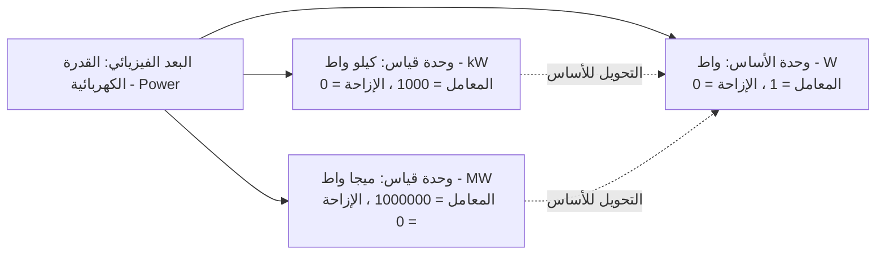

# أبعاد القياس، الوحدات وقواعد التحويل الرياضية

يوضح هذا المستند الأساس الرياضي والقيود الهندسية التي تضبط الأبعاد الفيزيائية والوحدات القياسية وقواعد التحويل التلقائية في قاعدة بيانات النظام.



---

## 1. الهيكل الهرمي لأنظمة القياس

يؤدي تباين الوحدات المدخلة من التجار دون حوكمة إلى فشل فلاتر التصفية (مثل تاجر يكتب سعة بطارية `5000 mAh` وآخر يكتب `5 Ah`).

يحل النظام هذه المعضلة عبر ثلاثة كيانات علائقية مترابطة:

1. **البُعد الفيزيائي (`measurement_dimensions`)**: الكمية الفيزيائية المجردة (مثل: الطول، الوزن، القدرة الكهربائية، السعة التخزينية).
2. **وحدة القياس (`measurement_units`)**: وحدة قياس معيارية تتبع بعداً فيزيائياً واحداً فقط (مثل: متر، سنتيمتر، مليمتر).
3. **قاعدة التحويل (`unit_conversion_rules`)**: علاقة رياضية صريحة لتحويل القيم بين وحدتين من نفس البعد.

---

## 2. معادلة التحويل الخطي إلى وحدة الأساس

ترتبط كل وحدة قياس بـ **وحدة الأساس المعتمدة (Base Unit)** الخاصة ببعدها الفيزيائي عبر معادلة تحويل خطي:

$$\text{القيمة بوحدة الأساس} = \text{القيمة بالوحدة الحالية} \times \text{to\_base\_multiplier} + \text{to\_base\_offset}$$

والمعادلة العكسية للتحويل من الأساس إلى الوحدة:

$$\text{القيمة بالوحدة الحالية} = \frac{\text{القيمة بوحدة الأساس} - \text{to\_base\_offset}}{\text{to\_base\_multiplier}}$$

### مثال 1: بُعد الطول (وحدة الأساس: متر)

- **سنتيمتر (`cm`)**:
  - `to_base_multiplier`: $0.01$
  - `to_base_offset`: $0$
  - الحساب: $150 \text{ cm} \times 0.01 + 0 = 1.5 \text{ متر}$.
- **كيلومتر (`km`)**:
  - `to_base_multiplier`: $1000$
  - `to_base_offset`: $0$
  - الحساب: $2.5 \text{ km} \times 1000 + 0 = 2500 \text{ متر}$.

### مثال 2: بُعد درجة الحرارة (وحدة الأساس: مئوية Celsius)

- **فهرنهايت (`°F`)**:
  - `to_base_multiplier`: $\frac{5}{9} \approx 0.5555555555555556$
  - `to_base_offset`: $-\frac{160}{9} \approx -17.77777777777778$
  - المعادلة: $C = (F - 32) \times \frac{5}{9}$.

---

## 3. القواعد الهندسية لوحدات الأساس

تفرض قاعدة البيانات شرطين رياضيين حاسمين:

### القاعدة 3.1: وحدة أساس نشطة واحدة فقط لكل بعد فيزيائي

مضمونة عبر الفهرس الفريد الجزئي في PostgreSQL:

```sql
create unique index measurement_units_one_base_per_dimension_uq
  on public.measurement_units(dimension_id) where is_base and status = 'active';
```

### القاعدة 3.2: معاملات وحدة الأساس دائماً حيادية

لكل وحدة تحمل السمة `is_base = true`:
$$\text{to\_base\_multiplier} = 1.0 \quad \text{و} \quad \text{to\_base\_offset} = 0.0$$

---

## 4. آلية تغيير وحدة الأساس تلقائياً (Rebasing Workflow)

عندما يقرر مسؤولو الكتالوج تغيير وحدة الأساس لبعد ما (مثلاً تغيير أساس سعة الذاكرة من `بايت` إلى `جيجابايت`)، تقوم دالة الـ RPC `set_measurement_unit_as_base(p_unit_id)` بإعادة حساب معاملات جميع الوحدات الشقيقة في عملية ذرية واحدة:

$$\text{المعامل الجديد} = \frac{\text{المعامل القديم}}{\text{معامل الوحدة المستهدفة}}$$

### مثال عملي

إذا كانت وحدة الأساس الحالية هي **بايت** (`B`):

- `بايت`: المعامل = $1$
- `كيلوبايت`: المعامل = $1024$
- `ميجابايت`: المعامل = $1048576$

إذا تم اعتماد **كيلوبايت** (`KB`) كوحدة الأساس الجديدة:

1. تصبح `كيلوبايت` هي `is_base = true` بمعامل $1$ وإزاحة $0$.
2. يصبح معامل `بايت`: $\frac{1}{1024} \approx 0.0009765625$.
3. يصبح معامل `ميجابايت`: $\frac{1048576}{1024} = 1024$.

يتم تحديث جميع قواعد التحويل التابعة دون أي أخطاء حسابية أو انقطاع في الخدمة.
