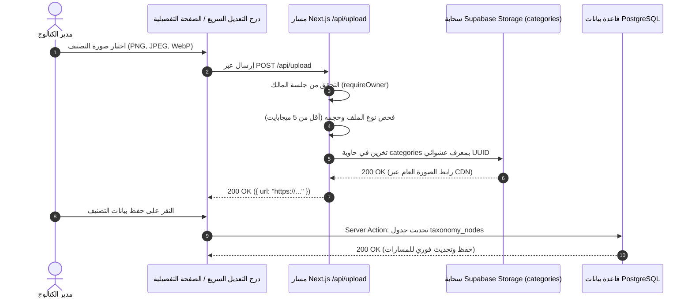

# تحرير التصنيفات، درج التعديل السريع ورفع الصور

يشرح هذا الدليل كيفية تعديل بيانات التصنيفات، وتوليد المفاتيح والروابط البرمجية تلقائياً، ورفع الصور السحابية إلى Supabase Storage، وضبط خصائص أنواع المنتجات.



---

## 1. درج التعديل السريع (Quick Edit Drawer)

بالضغط على أي تصنيف داخل شجرة العرض، يرتفع **درج التعديل السريع** (على شكل Bottom Sheet في الجوال أو لوح جانبي في الشاشات العريضة):

### الحقول المتاحة في التعديل السريع

- **الاسم بالعربية**: الحقل الأساسي الإلزامي.
- **الاسم بالإنجليزية**: حقل الترجمة المرجعي الاختياري.
- **الرابط الدائم (Slug)**: معرّف الرابط. إذا تم مسحه، يُولد تلقائياً من الاسم.
- **الأصل (Parent Node)**: قائمة اختيار تخضع للفحص الفوري لمنع الحلقات الدائرية.
- **ترتيب العرض (Sort Order)**: رقم صحيح يتحكم بأولوية الترتيب بين الأقران.

---

## 2. الصفحة التفصيلية الكاملة للتصنيف (`/categories/[id]`)

لضبط الإعدادات المتقدمة وربط الخصائص، يتم التوجه للصفحة التفصيلية الكاملة:

### الأقسام المتوفرة في الصفحة

1. **بطاقة البيانات الوصفية**: تعرض العمق الدقيق للعقدة، ومسارها الهرمي المخصب بالكامل، وتاريخ الإنشاء والتعديل.
2. **إدارة الصور البصرية**: أدوات رفع الصورة ومعاينتها أو حذفها.
3. **محرر خصائص نوع المنتج** (يظهر حصراً إذا كان نوع العقدة `product_type`):
   - جدول الخصائص المرتبطة.
   - تحديد الدور الاستراتيجي (`identity`, `variant`, `descriptive`, `commercial`).
   - تحديد مجموعة العرض وترتيب الظهور.
   - تفعيل الإلزامية وقابلية الفلترة.
   - ضبط الحدود الرقمية ووحدات القياس المتوافقة وقوائم القيم.

---

## 3. مسار رفع الصور السحابي الدائم

يتميز التطبيق بمسار رفع صور مباشر إلى السحابة عبر **Supabase Storage**:

### 3.1 المواصفات التقنية

- **نقطة النهاية**: `POST /api/upload`
- **الحاوية المستهدفة**: `categories`
- **أنواع الصور المقبولة**: `image/png`, `image/jpeg`, `image/webp`
- **الحد الأقصى للحجم**: `5 ميجابايت` (5,242,880 بايت)
- **هيكل المسار السحابي**: `categories/{node_id}-{timestamp}.{ext}`

### 3.2 الأمان والمصادقة البرمجية

يقتصر الرفع على الملاك المعتمدين؛ حيث يقوم مسار `/api/upload` بفحص جلسة المالك قبل معالجة أي بايت:

```typescript
// app/api/upload/route.ts
export async function POST(request: Request) {
  // 1. التحقق الإلزامي من جلسة المالك
  const { supabase } = await requireOwner();

  const formData = await request.formData();
  const file = formData.get('file') as File | null;

  if (!file) {
    return NextResponse.json({ error: 'لم يتم إرسال ملف' }, { status: 400 });
  }

  // 2. التحقق الصارم من نوع الملف وحجمه
  if (!['image/png', 'image/jpeg', 'image/webp'].includes(file.type)) {
    return NextResponse.json({ error: 'نوع الملف غير مدعوم' }, { status: 400 });
  }

  if (file.size > 5 * 1024 * 1024) {
    return NextResponse.json({ error: 'حجم الملف يتجاوز 5 ميجابايت' }, { status: 400 });
  }

  // 3. الرفع إلى حاوية Supabase Storage
  const filename = `${crypto.randomUUID()}-${file.name.replace(/[^a-zA-Z0-9.-]/g, '_')}`;
  const { data, error } = await supabase.storage
    .from('categories')
    .upload(filename, file, { contentType: file.type, upsert: false });

  if (error) {
    return NextResponse.json({ error: error.message }, { status: 500 });
  }

  // 4. استخراج الرابط العام
  const { data: { publicUrl } } = supabase.storage
    .from('categories')
    .getPublicUrl(filename);

  return NextResponse.json({ url: publicUrl });
}
```

---

## 4. المعالجة القياسية للروابط والمفاتيح البرمجية التلقائية

عند حفظ أي فئة أو تعريف مركزي وترك المفتاح أو الرابط فارغاً:

- تُولد روابط التصنيف عبر `generateSlug(name, existingSlugs)` لضمان مطابقتها للحروف اللاتينية والشرطات `-` وحل التعارض بترقيم فريد.
- تُولد المفاتيح الثابتة للتعريفات عبر `generateKey(nameEn, nameAr, existingKeys)` بصيغة `snake_case` تبدأ بحرف لاتيني صغير وتطابق قيود قاعدة البيانات حرفياً.
