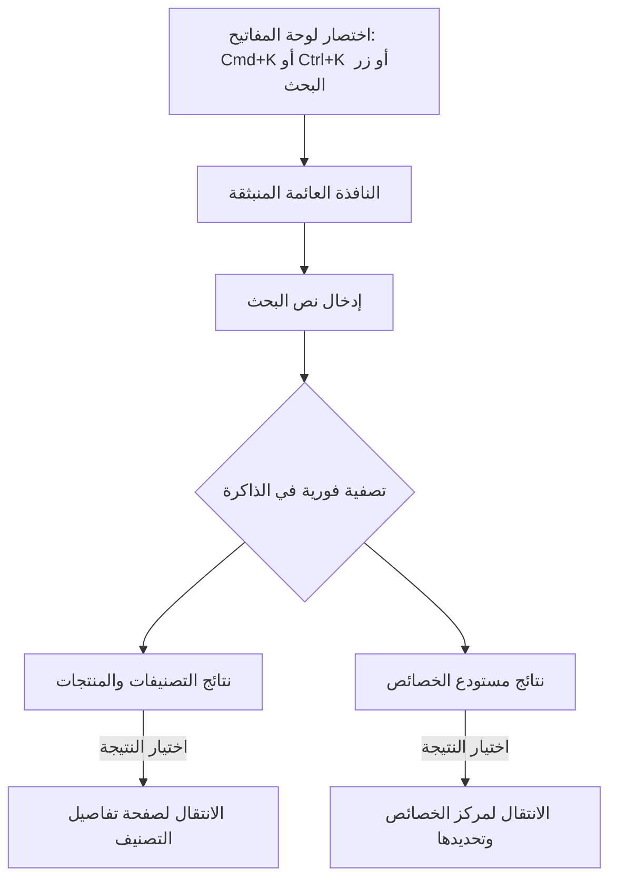

# لوحة البحث الشامل السريعة (Cmd+K)

يوثق هذا الدليل **لوحة البحث السريعة الشاملة (Spotlight Command Palette)** المتوفرة عبر مكتبة `cmdk`، والتي تتيح للمستخدمين التنقل اللحظي بين كافة أجزاء الكتالوج والخصائص بلوحة المفاتيح.

---

## 1. فتح وتشغيل لوحة البحث

يمكن استدعاء لوحة البحث في أي لحظة ومن أي صفحة داخل التطبيق:

- **أجهزة Mac**: الاختصار <kbd>Cmd</kbd> + <kbd>K</kbd>
- **أجهزة Windows و Linux**: الاختصار <kbd>Ctrl</kbd> + <kbd>K</kbd>
- **الواجهة البصرية**: النقر على أيقونة البحث في الشريط العلوي للموقع.

للإغلاق، يكفي الضغط على زر <kbd>Esc</kbd> أو النقر خارج النافذة.

---

## 2. قدرات البحث الشامل المتعدد

تقوم اللوحة بفرز نتائج البحث لحظياً ضمن مجموعتين رئيستين:

### 2.1 المجموعة الأولى: التصنيفات والمنتجات

- تبحث في الأسماء العربية والإنجليزية والروابط لجميع المستويات الهرمية الأربعة.
- تعرض المسار الهرمي المكتمل لكل نتيجة لتوفير السياق (مثال: `الإلكترونيات / الهواتف المحمولة / هواتف ذكية`).
- توضح شارة بصرية بجانب كل خيار تبين نوع العقدة (`قسم`, `تصنيف`, `تصنيف فرعي`, أو `نوع منتج`).

### 2.2 المجموعة الثانية: مستودع الخصائص المركزية

- تبحث في الأسماء العربية والإنجليزية والمفاتيح البرمجية للخصائص العامة.
- تعرض شارات نوع البيانات (`نص`, `رقم`, `منطقي`, `قائمة`) مع الأبعاد الفيزيائية المرتبطة بها إن وجدت.

---

## 3. التنقل الفوري عبر لوحة المفاتيح

- **الأسهم لأعلى ولأسفل (<kbd>↓</kbd> / <kbd>↑</kbd>)**: التنقل السريع والسلس بين النتائج المظللة.
- **زر الإدخال (<kbd>Enter</kbd>)**:
  - عند اختيار **تصنيف أو منتج**: يتم التوجيه فوراً لصفحة تفاصيل العقدة `/categories/[id]`.
  - عند اختيار **خاصية**: يتم التوجيه إلى مركز الخصائص `/attributes` مع فتح أو تسليط الضوء على الخاصية المختارة.
