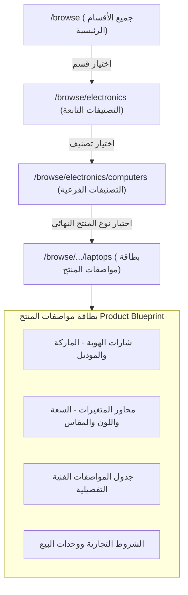

# محاكي واجهة المتجر للمتسوق وبطاقة مواصفات المنتج

يوثق هذا الدليل **محاكي واجهة المتجر** المتاح عبر المسار (`/browse/[[...slug]]`)، والذي يتيح لمخططي الكتالوج تجربة رحلة العميل البصرية والتحقق من سلامة **بطاقة مواصفات المنتج النهائي (Product Blueprint)**.



---

## 1. تجربة الملاحة البصرية للمتسوق (`/browse`)

يعرض المحاكي شجرة الكتالوج عبر بطاقات بصرية عصرية وسريعة التجاوب:

### 1.1 البطاقات البصرية الدائرية للتصنيفات

- تعرض كل بطاقة صورة التصنيف في إطار دائري أنيق، مصحوبة بالاسم العربي الأساسي والاسم الإنجليزي الفرعي، مع عداد حي لعدد الفروع المتفرعة منها.
- تشتمل البطاقات على تأثيرات حركية خفيفة عند تمرير الفأرة (Hover Lift) تعكس تجربة متاجر التجارة الإلكترونية العالمية.

### 1.2 مسار التتبع التفاعلي (Interactive Breadcrumbs)

أثناء التعمق في تفرعات المتجر، يثبت شريط تنقل ذكي في أعلى الصفحة لتوضيح الموقع الدقيق:

```text
الرئيسية  >  الأجهزة الإلكترونية  >  أجهزة الحاسوب  >  حواسيب محمولة
```

- يؤدي النقر على أي حبة سابقة في المسار إلى الرجوع الفوري لذلك المستوى.
- يتم تحديث مسار الرابط بشكل تلقائي نظيف عبر الـ Slugs: `/browse/electronics/computers/laptops`.

---

## 2. بطاقة مواصفات المنتج النهائي (Product Blueprint)

عند الوصول إلى عقدة ورقية تمثل نوع منتج نهائي (`product_type`)، ينتقل المحاكي من عرض بطاقات الأقسام إلى عرض **بطاقة مواصفات المنتج** (`ProductBlueprint.tsx`).

تقوم البطاقة بتنظيم الخصائص المرتبطة في أقسام مستقلة حسب **أدوارها الاستراتيجية**:

### 2.1 قسم خصائص الهوية (أيقونة الدرع `Shield`)

يعرض الخصائص الضرورية لتمييز الموديل وتجميع عروض التجار المتنافسين:

- **الماركة / العلامة التجارية**: تظهر في قمة البطاقة بوضوح فائق.
- **الموديل / Model**: الرمز التعريفي لخط الإنتاج.
- **رقم القطعة المصنعية (MPN)**: كود المطابقة الرئيسي.

### 2.2 قسم محاور المتغيرات (أيقونة الشبكة `LayoutGrid`)

يبرز الخصائص التي يختار منها المشتري خيارات الشراء:

- تحمل كل خاصية متغيرة شارة `مُتغير` البنفسجية.
- تُعرض القيم المسموحة على شكل خيارات منتقاة (مثل: `128 GB`, `256 GB`, `512 GB`).
- يتم إلحاق وحدة القياس المرتبطة تلقائياً بالقيم الرقمية.

### 2.3 جدول المواصفات الفنية (أيقونة البطاقات `Tags`)

جدول منظم يعرض الخصائص الوصفية:

- اسم الخاصية بالعربية والإنجليزية.
- وحدة القياس المستهدفة.
- القيم المسموحة أو الإشارة إلى أنها قيمة حرة.

### 2.4 قسم التفاصيل التجارية واللوجستية (أيقونة السلة `ShoppingCart`)

يوضح وحدات التعبئة والتجزئة والجملة والحد الأدنى للطلب.

---

## 3. اختصار التعديل الإداري المباشر

لتوفير أقصى درجات الراحة أثناء المراجعة البصرية، يشتمل رأس بطاقة المواصفات على زر إداري مباشر:

- **تعديل نوع المنتج**: يفتح صفحة إدارة المخطط `/categories/[id]` مباشرة في لسان جديد لتصحيح أو إضافة أي خاصية ناقصة فوراً.
