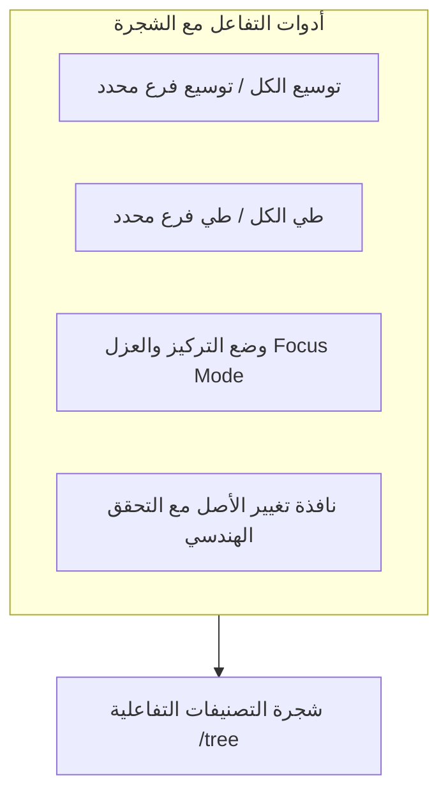

# إدارة الشجرة، وضع التركيز وقواعد نقل التبعية

يشرح هذا الدليل بالتفصيل كيفية التنقل داخل شجرة التصنيفات والتعديل عليها وتغيير أصل الفئات عبر **واجهة إدارة الشجرة** (`/tree`).



---

## 1. التنقل البصري في شجرة التصنيفات

توفر صفحة الشجرة (`/tree`) عرضاً هرمياً مكثفاً وواضحاً لكامل بنية الكتالوج في المتجر:

### 1.1 أدوات التحكم في التفرعات

- **طي وتوسيع العقد**: بالضغط على أيقونة السهم بجانب أي قسم أو تصنيف، يتم طي أو توسيع الفروع المباشرة التابعة له.
- **أزرار التحكم الجماعي**:
  - **توسيع الكل**: يفتح جميع مستويات الشجرة حتى الوصول إلى أنواع المنتجات الورقية.
  - **طي الكل**: يعيد إغلاق الشجرة ليبقى فقط مستوى الأقسام الرئيسية العليا.

### 1.2 شارات تمييز مستويات العقد

تحمل كل عقدة في الشجرة شارة بصرية توضح نوعها الهندسي:

- `قسم رئيسي`: شارة زرقاء مع أيقونة قطاع تجاري.
- `تصنيف`: شارة بنفسجية أنيقة.
- `تصنيف فرعي`: شارة سماوية فاتحة.
- `نوع منتج`: شارة كهرمانية مع عداد للخصائص المرتبطة به (مثل: `5 خصائص`).

---

## 2. وضع التركيز والعزل (Focus / Isolate Mode)

عندما تتضخم شجرة الكتالوج لتشمل آلاف التصنيفات، يصبح التمرير في شجرة طويلة أمراً مربكاً، خاصة على الشاشات الصغيرة وأجهزة الجوال.

يمكّنك **وضع التركيز** من عزل أي تفرع والتركيز عليه بمفرده:

1. مرر مؤشر الفأرة على أي تصنيف أو تصنيف فرعي.
2. اضغط على أيقونة **التركيز (Focus)**.
3. تختفي فوراً كافة الأقسام والتصنيفات الأخرى، ويظهر التصنيف المحدد كأنه الجذر المؤقت للواجهة.
4. يظهر شريط تنبيهي علوي يوضح مسار التفرع المعزول:

   ```text
   الوضع المركز: الإلكترونيات / الهواتف المحمولة  [ إلغاء وضع التركيز ✕ ]
   ```

5. بالضغط على **إلغاء وضع التركيز**، تعود الشجرة العالمية الكاملة فوراً للعرض.

---

## 3. تغيير التبعية ونقل التصنيف (Reparenting)

عند إعادة هيكلة الكتالوج ونقل تصنيف من قسم إلى آخر:

### الخطوة 3.1: فتح نافذة تغيير الأصل

1. من الشجرة أو درج التعديل السريع، اضغط على زر **تغيير الأصل**.
2. تفتح نافذة تحتوي على قائمة قابلة للبحث بجميع الأصول المتاحة هندسياً.

### الخطوة 3.2: منع الحلقات الدائرية رياضياً

تطبق القائمة خوارزمية استبعاد التفرع في الوقت الفعلي:

- **استبعاد الذات**: لا يمكن للتصنيف أن يختار نفسه كأب.
- **استبعاد الأب الحالي**: الأصل الحالي مستبعد لعدم الجدوى.
- **استبعاد التفرع السفلي بالكامل**: يتم استبعاد جميع الفروع والأحفاد المندرجة تحت هذا التصنيف تلقائياً لمنع خلق حلقات مغلقة تكسر شجرة العرض.

### الخطوة 3.3: التحقق الصارم من المستوى الهرمي

تتحقق النافذة من توافق المستويات قبل إرسال الطلب:

- القسم الرئيسي لا يمكن أن يكون إلا في المستوى الجذري (`parent_id = null`).
- التصنيف يوضع فقط تحت قسم رئيسي.
- التصنيف الفرعي يوضع فقط تحت تصنيف رئيسي.
- نوع المنتج يوضع تحت تصنيف أو تصنيف فرعي.

في حال أي مخالفة، تظهر رسالة عربية واضحة ومباشرة (مثال: *"لا يمكن نقل التصنيف إلى نفسه أو إلى أحد فروعه"*).

---

## 4. حوكمة حذف العقد

عند النقر على زر **حذف** لأي عقدة:

1. **حماية الفروع**: إذا كان التصنيف يحتوي على أبناء نشطين، يتم حظر الحذف برسالة تنبيهية تطلب نقل الفروع أو حذفها أولاً.
2. **حماية الخصائص**: إذا كان نوع المنتج يحتوي على خصائص مرتبطة، يُمنع الحذف حتى تُفصل الخصائص أولاً.
3. **الأرشفة الهادئة**: يتم تحويل العقد الفارغة إلى الحالة المؤرشفة `status = 'archived'` بدلاً من الحذف الفيزيائي للحفاظ على سلامة الروابط السابقة.
