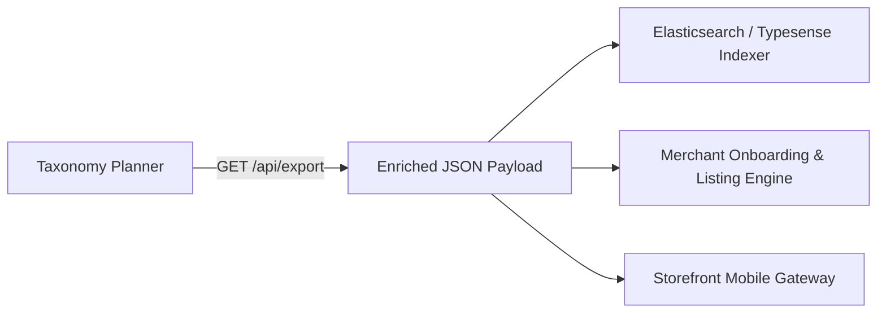

# Enriched JSON Schema & YCP Interoperability

This document defines the formal JSON Schema specification for the enriched catalog payload generated by the **Taxonomy & Catalog Planner** to feed the downstream **YCP Core Ingestion Engine**.

---

## 1. Architectural Role in YCP Ecosystem

Downstream e-commerce services (Elasticsearch/OpenSearch clusters, mobile client APIs, and merchant listing validators) must not perform complex recursive SQL queries on live operational databases to reconstruct hierarchy trees.

The **Enriched Flat Export** pre-calculates and denormalizes:
1. **Ancestry & Breadcrumbs**: Fully resolved path hierarchies for instant navigation.
2. **Depth Levels**: Direct numerical indicators for faceted filtering.
3. **Resolved Attribute Dictionaries**: Attribute keys, names, filter types, and allowed options embedded directly inside leaf nodes.



---

## 2. TypeScript Interface Definition

From `lib/utils/export.ts`:

```typescript
export interface EnrichedAttributeExport {
  attribute_id: string;
  name_ar: string;
  name_en?: string;
  data_type: 'number' | 'enum' | 'string' | 'boolean';
  filter_type: 'range' | 'checkbox' | 'select' | 'toggle' | 'color_swatch' | 'button_group';
  unit: string | null;
  role: 'identity' | 'variant' | 'descriptive' | 'commercial';
  group?: string;
  is_variant: boolean;
  allowed_values: string[];
}

export interface EnrichedBreadcrumb {
  id: string;
  name_ar: string;
  slug: string;
}

export interface EnrichedCategoryExport {
  id: string;
  name_ar: string;
  name_en: string | null;
  slug: string;
  node_type: 'department' | 'category' | 'subcategory' | 'product_type';
  parent_id: string | null;
  path: string; // e.g., "الكهرباء والإنارة / الإضاءة / لمبات / لمبة LED"
  depth: number; // 0 for root, 1, 2, ...
  breadcrumbs: EnrichedBreadcrumb[];
  image: string | null;
  attributes: EnrichedAttributeExport[];
}
```

---

## 3. Formal JSON Schema (Draft 7)

```json
{
  "$schema": "http://json-schema.org/draft-07/schema#",
  "title": "YCPEnrichedCatalogExport",
  "type": "array",
  "items": {
    "type": "object",
    "required": [
      "id",
      "name_ar",
      "slug",
      "node_type",
      "path",
      "depth",
      "breadcrumbs",
      "attributes"
    ],
    "properties": {
      "id": {
        "type": "string",
        "format": "uuid"
      },
      "name_ar": {
        "type": "string",
        "minLength": 1
      },
      "name_en": {
        "type": ["string", "null"]
      },
      "slug": {
        "type": "string",
        "pattern": "^[a-z0-9]+(?:-[a-z0-9]+)*$"
      },
      "node_type": {
        "type": "string",
        "enum": ["department", "category", "subcategory", "product_type"]
      },
      "parent_id": {
        "type": ["string", "null"],
        "format": "uuid"
      },
      "path": {
        "type": "string",
        "description": "Slash-separated breadcrumb trail in Arabic"
      },
      "depth": {
        "type": "integer",
        "minimum": 0,
        "maximum": 5
      },
      "breadcrumbs": {
        "type": "array",
        "items": {
          "type": "object",
          "required": ["id", "name_ar", "slug"],
          "properties": {
            "id": { "type": "string", "format": "uuid" },
            "name_ar": { "type": "string" },
            "slug": { "type": "string" }
          }
        }
      },
      "image": {
        "type": ["string", "null"],
        "format": "uri"
      },
      "attributes": {
        "type": "array",
        "items": {
          "type": "object",
          "required": [
            "attribute_id",
            "name_ar",
            "data_type",
            "filter_type",
            "role",
            "is_variant",
            "allowed_values"
          ],
          "properties": {
            "attribute_id": { "type": "string", "format": "uuid" },
            "name_ar": { "type": "string" },
            "name_en": { "type": "string" },
            "data_type": {
              "type": "string",
              "enum": ["string", "number", "boolean", "enum"]
            },
            "filter_type": {
              "type": "string",
              "enum": ["range", "checkbox", "select", "toggle", "color_swatch", "button_group"]
            },
            "unit": { "type": ["string", "null"] },
            "role": {
              "type": "string",
              "enum": ["identity", "variant", "descriptive", "commercial"]
            },
            "group": { "type": "string" },
            "is_variant": { "type": "boolean" },
            "allowed_values": {
              "type": "array",
              "items": { "type": "string" }
            }
          }
        }
      }
    }
  }
}
```
