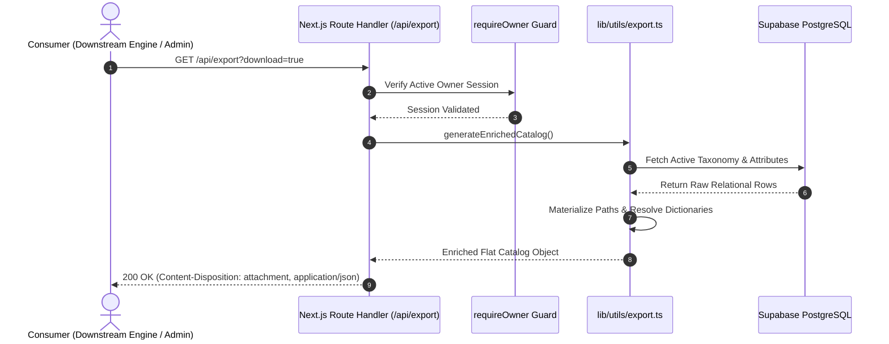

# Export Pipeline & HTTP API Endpoint (`/api/export`)

This document provides a technical specification for the `/api/export` Route Handler, including HTTP request/response contracts, security policies, and streaming parameters.



---

## 1. HTTP API Endpoint Specification

- **Method**: `GET`
- **Path**: `/api/export`
- **Authentication**: Mandatory (Supabase Auth Cookie + Active Owner in `app_authorized_users`)
- **Default Format**: `application/json; charset=utf-8`

### 1.1 Query Parameters

| Parameter | Type | Required | Default | Description |
| :--- | :--- | :---: | :---: | :--- |
| `download` | `boolean` | No | `false` | When set to `true`, appends a `Content-Disposition: attachment; filename="catalog-taxonomy-enriched.json"` header to trigger browser download. |

---

## 2. Request & Response Examples

### 2.1 Standard API Request (cURL)

```bash
curl -X GET "https://your-domain.com/api/export" \
  -H "Cookie: sb-access-token=eyJhbGciOi..." \
  -H "Accept: application/json"
```

### 2.2 Response Headers

```http
HTTP/1.1 200 OK
Content-Type: application/json; charset=utf-8
Content-Disposition: attachment; filename="catalog-taxonomy-enriched.json"
Cache-Control: no-store, max-age=0
```

### 2.3 Response Payload (Truncated Sample)

```json
[
  {
    "id": "e4b2d308-3a1e-450f-a49e-ec80d19f2a01",
    "name_ar": "هواتف ذكية",
    "name_en": "Smartphones",
    "slug": "smartphones",
    "node_type": "product_type",
    "parent_id": "c1f7b820-2d8c-4a33-87f5-231908bf9a11",
    "path": "الأجهزة الإلكترونية / الهواتف المحمولة / هواتف ذكية",
    "depth": 2,
    "breadcrumbs": [
      {
        "id": "a9e102f4-7c3d-4e56-9b11-209847120381",
        "name_ar": "الأجهزة الإلكترونية",
        "slug": "consumer-electronics"
      },
      {
        "id": "c1f7b820-2d8c-4a33-87f5-231908bf9a11",
        "name_ar": "الهواتف المحمولة",
        "slug": "mobile-phones"
      }
    ],
    "image": "https://your-project.supabase.co/storage/v1/object/public/categories/smartphones-banner.webp",
    "attributes": [
      {
        "attribute_id": "f8a12b3c-4d5e-6f7a-8b9c-0d1e2f3a4b5c",
        "name_ar": "سعة التخزين الداخلي",
        "name_en": "Internal Storage",
        "data_type": "number",
        "filter_type": "button_group",
        "unit": "GB",
        "role": "variant",
        "group": "الذاكرة والأداء",
        "is_variant": true,
        "allowed_values": ["128", "256", "512", "1024"]
      }
    ]
  }
]
```

---

## 3. Error Codes & Handling

| HTTP Status | Error Message | Cause / Resolution |
| :---: | :--- | :--- |
| `307 Temporary Redirect` | Redirects to `/login` | Missing or invalid Supabase authentication cookie. |
| `307 Temporary Redirect` | Redirects to `/unauthorized` | User is authenticated but lacks active owner entry in `app_authorized_users`. |
| `500 Internal Server Error` | `{"error": "Failed to generate export"}` | Database connection failure or unhandled exception during enrichment. |
