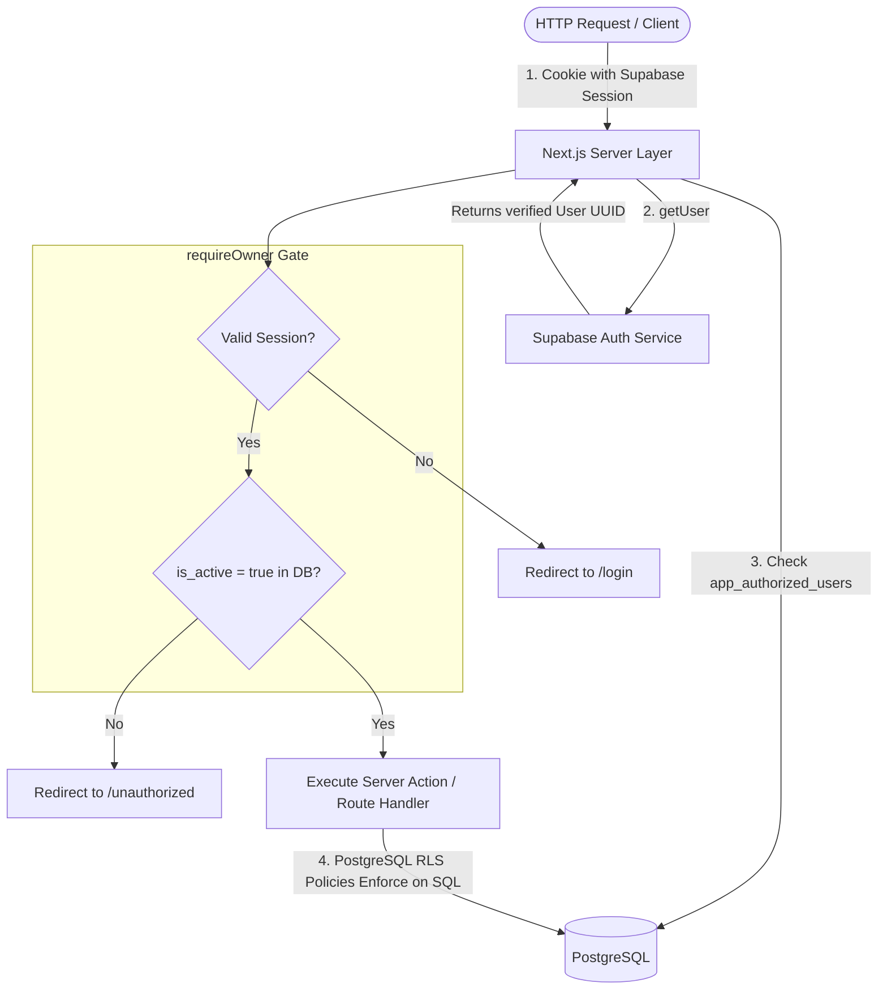

# Security, Authentication & Row-Level Security (RLS)

This document outlines the security architecture of the **Taxonomy & Catalog Planner**, detailing session management, the owner-only authorization gate, and PostgreSQL Row-Level Security (RLS) policies.



---

## 1. Authentication Foundation (`@supabase/ssr`)

The application integrates the official `@supabase/ssr` library to maintain secure, cookie-based sessions across Next.js Server Components, Server Actions, and Route Handlers.

### Why `@supabase/ssr` Over LocalStorage?
1. **CSRF Protection**: Tokens are stored in secure, `SameSite=Lax` cookies, shielding authentication tokens from browser XSS extraction.
2. **True SSR Capability**: Server Components read the active session directly from incoming request headers before HTML generation.
3. **Automatic Refresh**: Expired JWT tokens are seamlessly refreshed on the server without client-side redirects.

---

## 2. The Owner Authorization Gate (`requireOwner`)

A valid Supabase Auth account does **not** grant access to authoring tools. The application implements an explicit platform gate in `lib/auth/require-owner.ts`:

```typescript
import 'server-only';
import { redirect } from 'next/navigation';
import { createClient } from '@/lib/supabase/server';

export async function requireOwner() {
  const supabase = await createClient();
  const { data: { user }, error } = await supabase.auth.getUser();

  // Step 1: Validate session presence
  if (error || !user) {
    redirect('/login');
  }

  // Step 2: Validate active owner authorization in DB
  const { data: authorization, error: authError } = await supabase
    .from('app_authorized_users')
    .select('user_id')
    .eq('user_id', user.id)
    .eq('is_active', true)
    .maybeSingle();

  if (authError || !authorization) {
    redirect('/unauthorized');
  }

  return { supabase, user };
}
```

### Security Rules:
- **`server-only` Package Guard**: Ensures `requireOwner()` can never be imported into client components.
- **`getUser()` Over `getSession()`**: Validates the authentication token against Supabase Auth servers on every sensitive call, preventing spoofed JWT payloads.

---

## 3. PostgreSQL Row-Level Security (RLS)

Even if an attacker attempts to bypass Next.js Server Actions and communicate directly with the Supabase PostgREST API using the public `anon` key, PostgreSQL enforces strict Row-Level Security.

### 3.1 Revocation of Anonymous Access
All anonymous access (`anon` role) is revoked across all catalog and taxonomy tables:

```sql
revoke all on public.app_authorized_users from anon;
revoke all on public.taxonomy_nodes from anon;
revoke all on public.attributes from anon;
revoke all on public.product_type_schemas from anon;
revoke all on public.product_type_attributes from anon;
revoke all on public.measurement_dimensions from anon;
revoke all on public.measurement_units from anon;
revoke all on public.attribute_value_sets from anon;
revoke all on public.attribute_values from anon;
```

### 3.2 Dynamic Owner Policy Pattern
Every table enforces read and write policies based on the `app_authorized_users` subquery:

```sql
-- Pattern applied to all tables:
create policy "taxonomy_nodes_owner_select" on public.taxonomy_nodes
  for select to authenticated
  using (
    exists (
      select 1 from public.app_authorized_users a
      where a.user_id = (select auth.uid()) and a.is_active = true
    )
  );

create policy "taxonomy_nodes_owner_insert" on public.taxonomy_nodes
  for insert to authenticated
  with check (
    exists (
      select 1 from public.app_authorized_users a
      where a.user_id = (select auth.uid()) and a.is_active = true
    )
  );

create policy "taxonomy_nodes_owner_update" on public.taxonomy_nodes
  for update to authenticated
  using (
    exists (
      select 1 from public.app_authorized_users a
      where a.user_id = (select auth.uid()) and a.is_active = true
    )
  )
  with check (
    exists (
      select 1 from public.app_authorized_users a
      where a.user_id = (select auth.uid()) and a.is_active = true
    )
  );

create policy "taxonomy_nodes_owner_delete" on public.taxonomy_nodes
  for delete to authenticated
  using (
    exists (
      select 1 from public.app_authorized_users a
      where a.user_id = (select auth.uid()) and a.is_active = true
    )
  );
```

---

## 4. Supabase Storage Policies (`categories` Bucket)

The `categories` storage bucket hosts all category and product type visual assets:
- **Public Read Access**: Available globally through Supabase Storage CDN.
- **Restricted Write Access**: Insert/Update/Delete operations require authenticated owner context matching `app_authorized_users`.

```sql
create policy "owner_uploads_category_images"
  on storage.objects for insert to authenticated
  with check (
    bucket_id = 'categories' and
    exists (
      select 1 from public.app_authorized_users
      where user_id = auth.uid() and is_active = true
    )
  );
```
