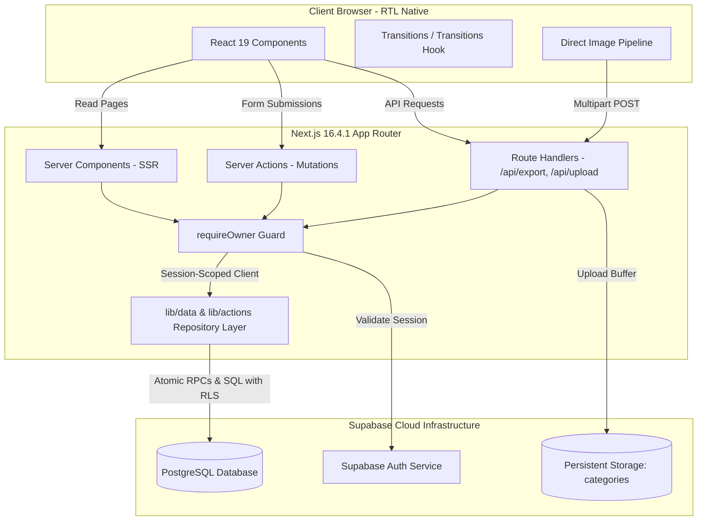

# System Architecture & Runtime Boundaries

This document details the software architecture of the **Taxonomy & Catalog Planner**, illustrating the request lifecycle, Server Components, Server Actions, Route Handlers, and trust boundaries.



---

## 1. Request Lifecycle & Rendering Strategy

The application leverages the **Next.js 16 App Router** with React 19, maximizing Server-Side Rendering (SSR) while isolating client interactivity to focused leaf components:

### 1.1 Server Components (RSC) by Default

All routes (`/`, `/tree`, `/taxonomy`, `/browse`, `/categories/[id]`, `/attributes`, `/value-sets`, `/measurements`, `/unit-conversions`) are Server Components:

- **Zero Client Waterfall**: Data is fetched directly on the server via session-scoped Supabase queries.
- **RTL & SEO Readiness**: Initial HTML is rendered with `dir="rtl"` and `lang="ar"`, eliminating layout shift during hydration.
- **Bundle Optimization**: Heavy parsing libraries and internal schemas remain on the server.

### 1.2 Interactive Client Leaves

Client components (`'use client'`) are strictly limited to interactive UI surfaces:

- `TreeManagementClient`: Tree expansion, collapse state, and focus/isolate mode.
- `QuickEditDrawer`: Bottom sheet sliding drawer for quick inline edits.
- `CategoryDetailClient`: Product type attribute binding and image management.
- `SpotlightPalette`: Command palette with keyboard shortcuts (`Cmd+K`).
- `MeasurementCenterManager`, `ValueSetManager`, `AttributeDefinitionManager`: Centralized definition authoring forms.

---

## 2. Mutations via Server Actions

All catalog mutations (creating nodes, reparenting, binding attributes, managing value sets, saving dimensions) are executed through Next.js **Server Actions**:

```typescript
'use server';

import { revalidatePath } from 'next/cache';
import { requireOwner } from '@/lib/auth/require-owner';
import { CategorySchema } from '@/lib/types/category';
import type { ActionResult } from '@/lib/types/action-result';

export async function saveCategoryAction(input: unknown): Promise<ActionResult> {
  // 1. Mandatory Owner Verification
  const { supabase, user } = await requireOwner();

  // 2. Strict Input Validation via Zod
  const parsed = CategorySchema.safeParse(input);
  if (!parsed.success) {
    return { success: false, error: parsed.error.issues[0]?.message };
  }

  // 3. Database Execution through Supabase client with RLS
  // ...
  
  // 4. Deterministic Cache Revalidation
  revalidatePath('/tree');
  revalidatePath('/taxonomy');
  revalidatePath('/browse', 'layout');

  return { success: true, data: null };
}
```

### Advantages of Server Actions in this Architecture

1. **Type Safety**: Full end-to-end TypeScript type inference without manual API boilerplate.
2. **Progressive Enhancement**: Graceful handling of network transitions via React 19's `useTransition()`.
3. **Atomic Cache Invalidation**: Precise cache eviction across all related routes (`revalidatePath`).

---

## 3. Trust Boundaries & Security Rules

The application enforces strict security invariants:

1. **No Client Privilege**: Client components never hold Supabase service-role keys. All browser requests communicate through the standard anon key, subject to PostgreSQL Row-Level Security.
2. **Identity from Verified Session**: The server extracts the authenticated actor strictly from the signed HTTP-only cookie session. Any user-supplied user ID in request bodies is discarded.
3. **Double Invariant Enforcement**:
   - **Layer 1 (Application/Zod)**: Fast feedback in TypeScript before making database round trips.
   - **Layer 2 (PostgreSQL Triggers & Constraints)**: Final, unbypassable database integrity enforcement.
4. **No Filesystem Persistence**: Historical local JSON files were eliminated. PostgreSQL is the live, atomic source of truth. Dual writing to disk and database is prohibited.
