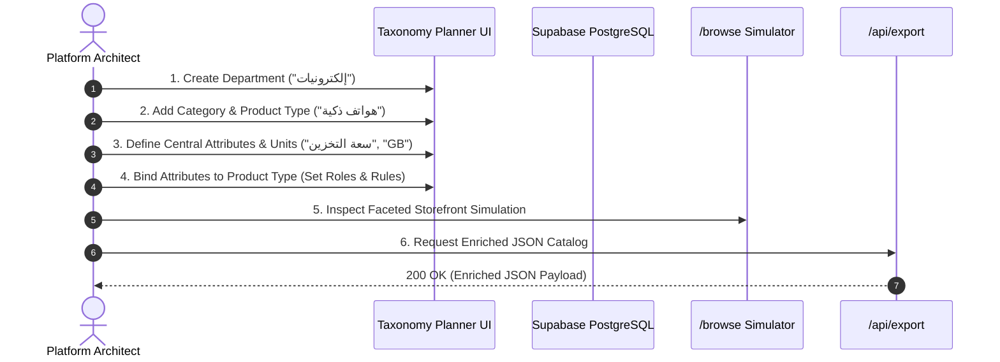

# Quick Start & Core Workflows

This guide provides an end-to-end walkthrough of the standard catalog modeling lifecycle in the **Taxonomy & Catalog Planner**.



---

## 1. Authentication & Signing In

1. Open `http://localhost:3000/login`.
2. Sign in with your registered email and password.
3. The system verifies that:
   - Your session cookie is valid.
   - Your user UUID exists in `app_authorized_users` with `is_active = true`.
4. Upon successful verification, you are redirected to the workspace dashboard at `/`.

---

## 2. Constructing the Taxonomy Tree

Navigate to `/tree` or `/taxonomy`:

### Step 2.1: Add a Root Department
1. Click **إضافة قسم رئيسي** (Add Department).
2. Enter the Arabic name (e.g., `الأجهزة الإلكترونية`) and English name (`Consumer Electronics`).
3. The system automatically derives a URL-safe, lowercase slug (`consumer-electronics` or `alajhzh-alalktrwnyh`).
4. Click **حفظ** (Save). The root department appears at the top level.

### Step 2.2: Add Nested Categories & Product Types
1. Hover over the newly created department and click the **+** button.
2. Select the node type:
   - Under `Department`, you can add a `Category` (e.g., `الهواتف المحمولة`).
   - Under `Category`, you can add a `Subcategory` or a leaf `Product Type` (e.g., `هواتف ذكية`).
3. Notice that leaf nodes (`Product Type`) are marked with a distinct badge indicating they are schema boundaries.

---

## 3. Defining Centralized Governance Entities

Before binding attributes, define reusable specifications in the Central Definition Centers (`/definitions`):

### Step 3.1: Create a Physical Dimension & Base Unit (`/measurements`)
1. Go to **مركز القياس والوحدات** (`/measurements`).
2. Add a Dimension:
   - Arabic Name: `سعة الذاكرة الرقمية` (Digital Memory Capacity).
   - English Name: `Digital Storage Capacity`.
   - Key: Leave blank to auto-generate `digital_storage_capacity`.
3. Add Units under this dimension:
   - **Byte** (Symbol: `B`): Set as Base Unit ($\text{multiplier}=1, \text{offset}=0$).
   - **Megabyte** (Symbol: `MB`): $\text{multiplier}=1048576, \text{offset}=0$.
   - **Gigabyte** (Symbol: `GB`): $\text{multiplier}=1073741824, \text{offset}=0$.

### Step 3.2: Create an Enum Value Set (`/value-sets`)
1. Go to **مركز القيم** (`/value-sets`).
2. Add Value Set:
   - Name: `ألوان الأجهزة` (Device Colors).
   - Key: Auto-generated as `device_colors`.
3. Add Values:
   - Label: `أسود فلكي` (Space Black), Value Key: `space_black`, Raw Value: `#1C1C1E`.
   - Label: `فضي ناصع` (Silver), Value Key: `silver`, Raw Value: `#E2E2E2`.

### Step 3.3: Define Global Attributes (`/attributes`)
1. Go to **مركز الخصائص** (`/attributes`).
2. Add Attribute:
   - Name: `سعة التخزين الداخلي` (Internal Storage).
   - Data Type: `number`.
   - Filter Type: `button_group`.
   - Dimension: Link to `سعة الذاكرة الرقمية`.

---

## 4. Binding Attributes to a Product Type (`/categories/[id]`)

1. Navigate to `/categories/[id]` for the `هواتف ذكية` (Smartphones) Product Type.
2. Under **خصائص نوع المنتج** (Product Type Attributes), click **ربط خاصية** (Bind Attribute).
3. Select `سعة التخزين الداخلي` (Internal Storage).
4. Configure its role and behavior:
   - **Role**: `variant` (drives customer SKU selection).
   - **Required**: `true`.
   - **Filterable**: `true`.
   - **Compatible Unit**: Select `GB`.
   - **Allowed Values / Bounds**: `128, 256, 512, 1024`.
5. Click **حفظ التغييرات** (Save Changes).

---

## 5. Simulating the Storefront (`/browse`)

1. Click **تصفح المتجر** (Browse Storefront) or visit `/browse`.
2. Navigate down the visual circular cards:
   `الأجهزة الإلكترونية` $\to$ `الهواتف المحمولة` $\to$ `هواتف ذكية`.
3. At the leaf level, view the **Product Specification Blueprint**:
   - Identity attributes (e.g., Brand, Model) are badged with a shield icon.
   - Variant axes (Storage, Color) are highlighted for matrix generation.
   - Descriptive and commercial specifications are organized in structured tables.

---

## 6. Exporting to Production (`/api/export`)

Execute an authenticated HTTP GET request to export the entire catalog:

```bash
curl -X GET "http://localhost:3000/api/export?download=true" \
  -H "Cookie: sb-access-token=..." \
  -o catalog-taxonomy-enriched.json
```

The resulting JSON file contains materialized paths, depth levels, breadcrumbs, and fully resolved attribute models ready for your production search cluster or merchant ingestion engine.
