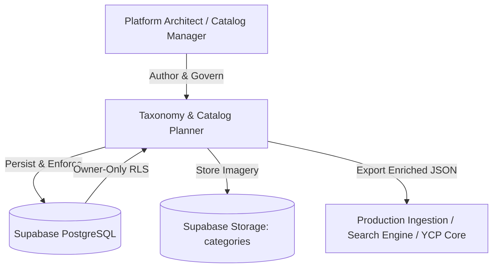

# Taxonomy & Catalog Planner — System Overview

The **Taxonomy & Catalog Planner** is an enterprise-grade visual modeling and governance suite engineered for **YCP (Yemen Commerce Platform)**. It provides platform architects, taxonomy specialists, and catalog managers with a unified, mathematically consistent environment to design, refine, and enforce global e-commerce taxonomies, attribute dictionaries, Product Type schemas, physical measurement systems, and vocabulary sets.

---

## 1. Executive Summary & Strategic Mission

In a multi-vendor, enterprise-scale marketplace, catalog chaos is one of the highest risks to buyer conversion, faceted navigation performance, and merchant onboarding efficiency. Common failure modes include:

1. **Inconsistent Hierarchies**: Deeply nested, arbitrary category structures with circular parent loops.
2. **Scattered Attribute Definitions**: Attributes duplicated with subtle spelling differences (e.g., `Color`, `Colour`, `color_code`, `اللون`), preventing aggregated search filters.
3. **Unregulated Physical Units**: Unstandardized units of measurement (e.g., mixing `kW` and `W` without mathematical conversion factors).
4. **Ad-hoc Variant Generation**: Unbounded matrix explosions caused by treating non-variant attributes as SKU axes.

The **Taxonomy & Catalog Planner** solves these challenges before catalog definitions ever touch production transactional databases. It acts as the single source of truth for taxonomy structure and product classification rules.

---

## 2. Core Architectural Pillars

### 2.1 Strictly Governed 4-Tier Hierarchy
The platform mathematically enforces a rigid 4-tier model:
$$\text{Department} \longrightarrow \text{Category} \longrightarrow \text{Subcategory (Optional)} \longrightarrow \text{Product Type}$$

- **Non-Negotiable Leaf Boundary**: Only `Product Type` nodes can hold bound attribute schemas. Upper nodes (`Department`, `Category`, `Subcategory`) are strictly organizational and navigation containers.
- **Cycle Prevention**: The tree authoring engine prevents circular reparenting using the *Subtree Disqualification Algorithm*.

### 2.2 Centralized Semantic Definitions
Attributes, Enum Value Sets, Physical Dimensions, and Measurement Units are defined in global governance centers. When assigned to a Product Type, attributes reference their central definition:
- Central changes (e.g., updating translations or adding aliases) immediately propagate.
- Deletions are safeguarded: active references cannot be deleted; they must be safely archived.

### 2.3 Strict Owner-Only Security Model
Global catalog schemas define the blueprint for the entire commerce ecosystem. Authorization is strictly enforced:
- **Authentication**: Managed via Supabase Auth session cookies (`@supabase/ssr`).
- **Owner Allowlist**: Access to authoring mutations requires verification against the `app_authorized_users` table with `is_active = true`.
- **Row-Level Security (RLS)**: Enforced directly inside PostgreSQL for all tables and RPCs.

### 2.4 High-Performance Materialized Export
Downstream consumers (search indexers, storefront microservices, mobile apps) require denormalized, enriched catalog payloads. The `/api/export` endpoint serves an atomic snapshot containing:
- Pre-calculated materialized breadcrumb paths (e.g., `"الكهرباء والإنارة / الإضاءة / لمبات"`).
- Exact node depths.
- Resolved attribute dictionaries, roles, and allowed enum value lists.

---

## 3. Technology Baseline

| Layer | Technology | Specification / Version |
| :--- | :--- | :--- |
| **Framework** | Next.js App Router | `16.4.1` (Turbopack, Server Actions, Route Handlers) |
| **UI Library** | React & React DOM | `19.3.0` |
| **Language** | TypeScript | `^6.0.3` (Strict mode) |
| **Styling** | Tailwind CSS | `4.x` (RTL-first, semantic CSS variables) |
| **Database** | PostgreSQL | Supabase Managed Cloud (Triggers, Foreign Keys, RLS) |
| **Session Client**| `@supabase/ssr` & `@supabase/supabase-js` | `0.12.7` / `2.117.3` |
| **Validation** | Zod | `4.6.5` |
| **Command Menu** | cmdk | `1.1.1` |
| **Typography** | Google Fonts | IBM Plex Sans Arabic / Inter |

---

## 4. Scope & System Boundaries

### What This System IS:
- A modeling, authoring, and governance suite for e-commerce catalog schemas.
- A central dictionary for attributes, measurement dimensions, and standardized units.
- A storefront simulation environment (`/browse`) validating customer-facing faceted browsing.
- An export pipeline feeding downstream YCP ingestion engines.

### What This System IS NOT:
- **NOT** a live transactional storefront (no cart, no checkout, no payment gateways).
- **NOT** an inventory or warehouse management system (WMS).
- **NOT** a merchant portal (no merchant product listings, pricing, or seller payouts).
- **NOT** a multi-tenant SaaS application (authoring is single-owner governed).
