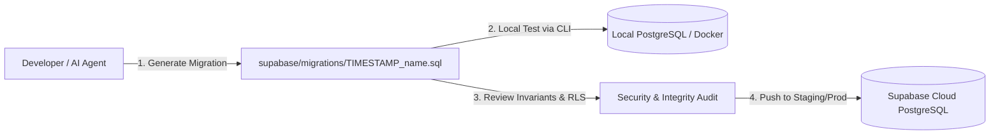

# Database Migrations & Supabase Lifecycle

This document provides a technical guide to managing, writing, and deploying PostgreSQL migrations in the **Taxonomy & Catalog Planner** using the Supabase CLI and SQL versioning.



---

## 1. Migration Philosophy & Rules

1. **Additive and Non-Destructive**: Every migration must be additive. Never run bulk `DROP TABLE` or destructive rewrites on existing taxonomy or attribute data.
2. **Deterministic Versioning**: All migrations reside in `supabase/migrations/` prefixed with UTC timestamps (`YYYYMMDDHHMMSS_description.sql`).
3. **No Local Reseeding**: Never reset or reseed existing catalog databases as part of standard feature work.
4. **Idempotence & Safety**: Use `IF EXISTS` / `IF NOT EXISTS` and check constraints so that rerunning a script does not corrupt production state.

---

## 2. Chronological Migration History

| Version Timestamp | File Name | Key Purpose & Structural Changes |
| :--- | :--- | :--- |
| `20261015175117` | `taxonomy_core_tables.sql` | Creates `app_authorized_users`, `taxonomy_nodes`, `attributes`, `product_type_schemas`, `product_type_attributes`. |
| `20261015175142` | `taxonomy_supporting_tables_and_rls.sql` | Creates aliases, value sets, measurement dimensions, units, conversion rules, and baseline RLS policies. |
| `20261015175318` | `index_foreign_keys.sql` | Adds covering indexes to all foreign key columns to eliminate sequential scan locks. |
| `20261015182130` | `snapshot_repository_rpc_functions.sql` | Defines PL/pgSQL RPCs for atomic reading and writing of full catalog snapshots. |
| `20261015182602` | `atomic_catalog_snapshot_rpc.sql` | Implements `get_catalog_snapshot()` resolving nodes and bound attributes in a single round-trip. |
| `20261015191025` | `categories_storage_bucket_and_owner_policies.sql` | Provisions the `categories` Supabase Storage bucket with public read and owner-only upload policies. |
| `20261015204655` | `enforce_taxonomy_placement_rules.sql` | Enforces 4-tier hierarchy validation via deferred PostgreSQL triggers. |
| `20261015204746` | `enforce_taxonomy_placement_and_product_type_schema.sql` | Restricts schema creation strictly to leaf `product_type` nodes. |
| `20261015204844` | `global_active_taxonomy_slug_uniqueness.sql` | Enforces global uniqueness across active taxonomy slugs for reliable `/browse` routing. |
| `20261016000004` | `product_type_attribute_editor.sql` | Introduces the `save_product_type_attribute_assignments` atomic transaction RPC. |
| `20261016100000` | `taxonomy_node_description.sql` | Adds nullable `description` column to `taxonomy_nodes`. |
| `20261016120000` | `central_attribute_definition_integrity.sql` | Creates `save_attribute_definition` RPC with filter compatibility checks and alias deduplication. |
| `20261016173835` | `value_unit_conversion_integrity.sql` | Adds foreign key from conversion rules to selling units. |
| `20261016174003` | `measurement_unit_workflows.sql` | Implements `save_measurement_unit` and `set_measurement_unit_as_base` rebasing RPCs. |
| `20261016175400` | `rebase_archived_measurement_units.sql` | Handles archival safety during unit rebasing. |
| `20261016175606` | `measurement_dimension_base_invariant.sql` | Enforces strict rule: a dimension cannot exist without at least one active base unit. |

---

## 3. Creating & Applying New Migrations

### 3.1 Generating a New Migration File
Using the Supabase CLI:

```bash
supabase migration new add_feature_xyz
```

This creates a timestamped file in `supabase/migrations/20261017000000_add_feature_xyz.sql`.

### 3.2 Writing Safe Migration SQL
Always wrap new DDL in an idempotent block with RLS:

```sql
-- Example: Adding a custom metadata field
alter table public.attributes
  add column if not exists search_boost numeric(3,2) not null default 1.0;

-- Ensure RLS is active
alter table public.attributes enable row level security;
```

### 3.3 Deploying Migrations
To push migrations to your remote Supabase project:

```bash
# Link project ref
supabase link --project-ref your-project-id

# Push pending migrations
supabase db push
```
