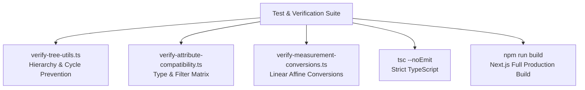

# Testing, Tree Invariants & Verification Scripts

This document details automated verification protocols, mathematical tree invariant testing, and diagnostic scripts used to ensure zero regression across the catalog.



---

## 1. Automated Verification Scripts

The repository includes standalone TypeScript verification scripts under `scripts/`. These scripts execute in pure Node.js environments via `npx tsx` and test domain algorithms independently of UI frameworks:

### 1.1 `scripts/verify-tree-utils.ts`
Tests tree hierarchy construction, ancestor resolution, and cycle prevention algorithms:
- **Depth Calculation**: Verifies that root nodes receive depth 0 and children increment sequentially.
- **Cycle Prevention**: Validates that `getForbiddenParentIds` blocks a node, its parent, and all nested descendants.
- **Placement Rules**: Asserts that `validateNodePlacement` blocks invalid relations (e.g., placing a `subcategory` directly under a `department`).

To run:
```bash
npx tsx scripts/verify-tree-utils.ts
```

### 1.2 `scripts/verify-attribute-compatibility.ts`
Tests the compatibility matrix between primitive data types and filter visual modes:
- Validates that `number` allows `range` but rejects `color_swatch`.
- Validates that `enum` allows `color_swatch` and `button_group`.
- Ensures legacy mismatches are safely detected without throwing unhandled exceptions.

To run:
```bash
npx tsx scripts/verify-attribute-compatibility.ts
```

### 1.3 `scripts/verify-measurement-conversions.ts`
Tests physical conversion mathematics:
- Validates linear affine transformation formulas: $\text{Value}_{\text{base}} = \text{Value} \times m + o$.
- Validates inverse transformations: $\text{Value} = \frac{\text{Value}_{\text{base}} - o}{m}$.
- Checks rounding precision across floating-point values up to 18 decimal places.

To run:
```bash
npx tsx scripts/verify-measurement-conversions.ts
```

---

## 2. Static Analysis & Type Safety Checks

TypeScript is configured in strict mode. To verify that all types across Server Actions, data layers, and UI components compile with zero errors:

```bash
npx tsc --noEmit
```

### Key Type Safety Enforcements:
- No implicit `any`.
- Strict null checks across database nullable foreign keys (`parent_id`, `name_en`, `image_path`).
- Zod schema inference synchronized with database types.

---

## 3. Production Build Verification

The ultimate integrity check verifies that Next.js App Router successfully compiles all static routes, dynamic handlers, server actions, and Turbopack optimizations:

```bash
npm run build
```

A successful build output concludes with:
```text
✓ Compiled successfully
  Collecting page data ...
✓ Generating static pages (8/8)
  Finalizing page optimization ...

Route (app)
├ ƒ /
├ ƒ /attributes
├ ƒ /browse/[[...slug]]
├ ƒ /categories/[id]
├ ○ /data-types
├ ○ /definitions
├ ƒ /measurements
├ ƒ /taxonomy
├ ƒ /tree
├ ƒ /unit-conversions
└ ƒ /value-sets
```
