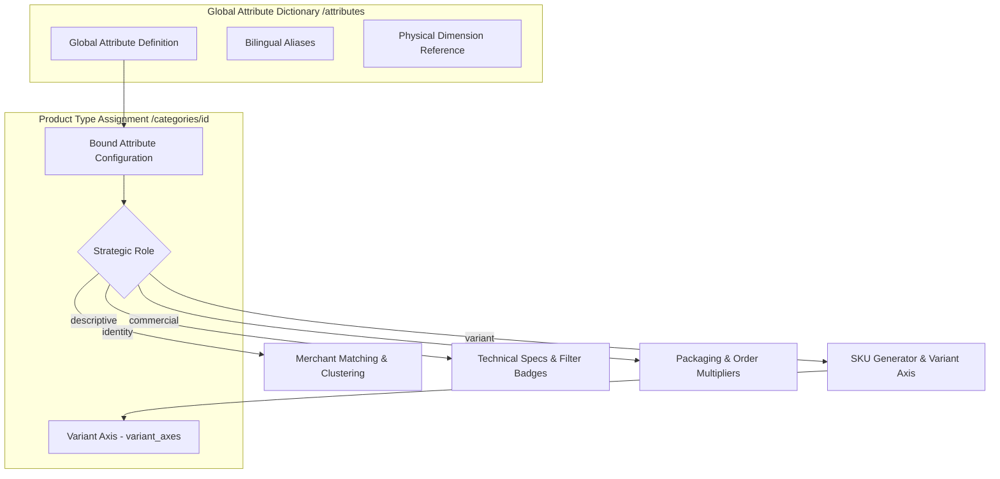

# Attribute Dictionary & The 4 Strategic Roles

This document details the global attribute dictionary, primitive data types, compatible filter behaviors, and the **4 Attribute Roles** foundational to modern PIM (Product Information Management) systems.



---

## 1. Global Attribute Architecture

In the **Taxonomy & Catalog Planner**, attributes are defined centrally once in the global dictionary (`/attributes`) and referenced across multiple Product Types:

### Key Properties:
- `key`: Unique programmatic snake_case identifier (e.g., `screen_size`, `ram_capacity`, `color_temp`). If left blank, automatically generated from English or Arabic transliteration.
- `name_ar`: Primary Arabic label (e.g., `حجم الشاشة`).
- `name_en`: Optional English reference label (e.g., `Screen Size`).
- `data_type`: System primitive type (`string`, `number`, `boolean`, `enum`).
- `filter_type`: Visual faceted search widget (`range`, `checkbox`, `select`, `toggle`, `color_swatch`, `button_group`).
- `measurement_dimension_id`: Mandatory for physical numbers (e.g., linking `screen_size` to `Length`).

---

## 2. The 4 Strategic Attribute Roles

When an attribute is bound to a `product_type`, it must be assigned exactly one **Role**. This role defines how merchant ingestion engines, search indexers, and storefronts interpret the attribute:

| Role | Arabic Term | Core Responsibility | Drives Variants (SKUs)? | Faceted Search? | Example |
| :--- | :--- | :--- | :---: | :---: | :--- |
| **`identity`** | هوية المنتج | Uniquely identifies product models; powers automated merchant product clustering and catalog matching | ❌ No | ⚠️ Rare | `الموديل`, `رقم القطعة المصنعية (MPN)`, `العلامة التجارية` |
| **`variant`** | محور التباين | Customer-selectable configurations; generates distinct sellable child SKUs under a parent product | ✅ **YES** | ✅ Yes | `اللون`, `المقاس`, `سعة التخزين الداخلي` |
| **`descriptive`** | مواصفات فنية | Detailed technical and functional properties; informs buyer decision-making and faceted filters | ❌ No | ✅ Yes | `دقة الشاشة`, `نوع المعالج`, `تقنية البلوتوث` |
| **`commercial`** | تجاري ولوجستي | Logistics, packaging, minimum order quantities, and commercial terms | ❌ No | ⚠️ Contextual | `وحدة البيع للتاجر`, `الكمية في الصندوق`, `بلد المنشأ` |

---

## 3. Detailed Role Specifications

### 3.1 `identity` (Identity Attributes)
Identity attributes are the cornerstone of multi-vendor marketplace efficiency. When multiple merchants upload the same physical product (e.g., *Sony WH-1000XM5 Headphones*), the marketplace uses identity attributes (`brand`, `model_number`, `gtin`) to cluster offers under a single canonical catalog card.

- **Integrity Invariant**: Identity attributes cannot be marked as variant axes (`is_variant = false`).

### 3.2 `variant` (Variant Axes)
Variant attributes allow customers to choose configurations on a single product page (e.g., selecting *128GB* vs. *256GB*).
- **Automated Synchronization**: Binding an attribute with `role = 'variant'` or `is_variant = true` creates a corresponding entry in `public.variant_axes`.
- **SKU Generation**: Downstream YCP engines use the Cartesian product of variant axes to generate discrete sellable SKUs:
  $$\text{SKUs} = \prod_{i=1}^{n} |\text{AllowedValues}(\text{Axis}_i)|$$

### 3.3 `descriptive` (Descriptive Specifications)
Descriptive attributes detail the product's capabilities. They populate specification comparison tables and power high-conversion faceted filters (e.g., filtering laptops with *RAM $\ge$ 16GB* and *IPS Screen*).

### 3.4 `commercial` (Commercial & Packaging)
Commercial attributes regulate trade mechanics: wholesale carton quantities, master case packaging, and selling increments.

---

## 4. Primitive Data Types & Compatible Filters

The application enforces type-to-filter compatibility via `lib/domain/attribute-compatibility.ts`:

| Primitive Data Type | Allowed Compatible Filter Types | Validation Rules |
| :--- | :--- | :--- |
| **`string`** | `select`, `checkbox`, `button_group` | Text values; length $\le 200$. |
| **`number`** | `range`, `select`, `button_group` | Finite numbers; supports numeric bounds (`min_value <= max_value`); optional physical dimension. |
| **`boolean`** | `toggle`, `checkbox`, `button_group` | Boolean flags (`true` / `false`). |
| **`enum`** | `select`, `checkbox`, `button_group`, `color_swatch` | Restricted vocabulary; requires a linked `value_set`. |

```typescript
export function isCompatibleFilter(dataType: DataType, filterType: FilterType | null): boolean {
  if (!filterType) return true;
  const allowed = COMPATIBILITY_MATRIX[dataType];
  return allowed ? allowed.includes(filterType) : false;
}
```
