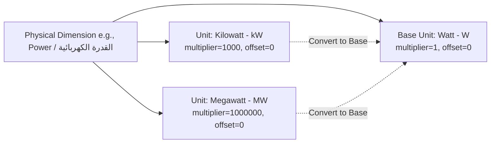

# Measurements, Dimensions & Unit Conversions

This document details the mathematical framework and database constraints governing physical measurement dimensions, standardized units, and automatic unit conversion rules.



---

## 1. The Dimensional Hierarchy

E-commerce marketplaces fail when numeric values lack standardized dimensional context (e.g., one vendor lists a power generator as `5 kW` and another as `5000 W`).

The **Taxonomy & Catalog Planner** models measurements across three entities:
1. **Measurement Dimension** (`measurement_dimensions`): The abstract physical quantity (e.g., `Length`, `Weight`, `Power`, `Electric Voltage`, `Digital Storage`).
2. **Measurement Unit** (`measurement_units`): A specific standard of measurement belonging to exactly one dimension (e.g., `Meter`, `Centimeter`, `Millimeter`).
3. **Unit Conversion Rule** (`unit_conversion_rules`): Direct mathematical relationship between two units of the same dimension.

---

## 2. The Linear Transformation Formula

Every unit relates to the designated **Base Unit** of its physical dimension through a standard linear affine transformation:

$$\text{Value}_{\text{base}} = \text{Value}_{\text{unit}} \times \text{to\_base\_multiplier} + \text{to\_base\_offset}$$

And the inverse transformation:

$$\text{Value}_{\text{unit}} = \frac{\text{Value}_{\text{base}} - \text{to\_base\_offset}}{\text{to\_base\_multiplier}}$$

### Example: Length (Base Unit: Meter)
- **Centimeter (`cm`)**:
  - `to_base_multiplier`: $0.01$
  - `to_base_offset`: $0$
  - Calculation: $150 \text{ cm} \times 0.01 + 0 = 1.5 \text{ m}$.
- **Kilometer (`km`)**:
  - `to_base_multiplier`: $1000$
  - `to_base_offset`: $0$
  - Calculation: $2.5 \text{ km} \times 1000 + 0 = 2500 \text{ m}$.

### Example: Temperature (Base Unit: Celsius)
- **Fahrenheit (`°F`)**:
  - `to_base_multiplier`: $\frac{5}{9} \approx 0.5555555555555556$
  - `to_base_offset`: $-\frac{160}{9} \approx -17.77777777777778$
  - Formula: $C = (F - 32) \times \frac{5}{9} = F \times \frac{5}{9} - 17.7778$.

---

## 3. Base Unit Invariants

The database enforces two strict mathematical invariants:

### Invariant 3.1: Exactly One Active Base Unit Per Dimension
Enforced by PostgreSQL unique index `measurement_units_one_base_per_dimension_uq`:
```sql
create unique index measurement_units_one_base_per_dimension_uq
  on public.measurement_units(dimension_id) where is_base and status = 'active';
```

### Invariant 3.2: Base Unit Factors Must Be Identity
For any unit marked `is_base = true`:
$$\text{to\_base\_multiplier} = 1.0 \quad \text{AND} \quad \text{to\_base\_offset} = 0.0$$

---

## 4. Automatic Base Unit Rebasing Workflow

When catalog administrators decide to change the base unit of a dimension (e.g., switching the base unit of Digital Storage from `Byte` to `Gigabyte`), the RPC function `set_measurement_unit_as_base(p_unit_id)` automatically recalculates all sibling units in a single transaction:

$$\text{New Multiplier} = \frac{\text{Old Multiplier}}{\text{Target Unit Old Multiplier}}$$

### Concrete Rebasing Example:
Suppose the current base unit is **Byte** (`B`):
- `Byte`: multiplier = $1$
- `Kilobyte`: multiplier = $1024$
- `Megabyte`: multiplier = $1048576$

If **Kilobyte** (`KB`) is promoted to the new Base Unit:
1. `Kilobyte` becomes `is_base = true`, multiplier = $1$, offset = $0$.
2. `Byte` multiplier becomes $\frac{1}{1024} \approx 0.0009765625$.
3. `Megabyte` multiplier becomes $\frac{1048576}{1024} = 1024$.

All active conversion rules are refreshed atomically, preventing mathematical discrepancies.
