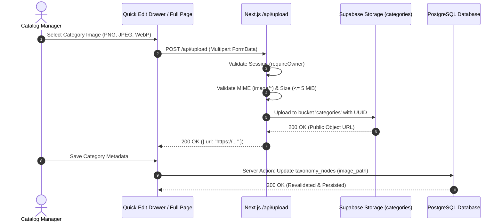

# Category Authoring & Image Upload Pipeline

This guide covers editing category metadata, updating slug identifiers, uploading persistent images to Supabase Storage, and configuring Product Type attributes.



---

## 1. Quick Edit Drawer (Inline Editing)

Clicking any category node in the Tree View opens the **Quick Edit Drawer** (a bottom sheet on mobile and side panel on desktop):

### Available Quick Fields:
- **الاسم بالعربية (Arabic Name)**: Primary required name.
- **الاسم بالإنجليزية (English Name)**: Optional reference translation.
- **الرابط الدائم (Slug)**: Canonical URL segment. If cleared, automatically regenerated.
- **الأصل (Parent Node)**: Dropdown with real-time cycle prevention.
- **ترتيب العرض (Sort Order)**: Explicit integer controlling display position.

---

## 2. Comprehensive Details Page (`/categories/[id]`)

For full schema configuration and image authoring, navigate to `/categories/[id]`:

### Sections on the Full Details Page:
1. **Metadata Card**: Displays derived depth, full materialized path, node type badge, and creation timestamps.
2. **Visual Asset Management**: Image upload, preview, and removal tools.
3. **Product Type Schema Editor** (Visible only if `node_type === 'product_type'`):
   - Attribute binding table.
   - Strategic Role selector (`identity`, `variant`, `descriptive`, `commercial`).
   - Grouping and display ordering.
   - Filterability and requirement toggles.
   - Numeric bounds and compatible measurement units.

---

## 3. Persistent Image Upload Pipeline

The application features a secure, direct-to-cloud image upload pipeline powered by **Supabase Storage**:

### 3.1 Technical Specifications:
- **Endpoint**: `POST /api/upload`
- **Target Bucket**: `categories`
- **Allowed MIME Types**: `image/png`, `image/jpeg`, `image/webp`
- **Maximum File Size**: `5 MiB` (5,242,880 bytes)
- **Path Structure**: `categories/{node_id}-{timestamp}.{ext}`

### 3.2 Security & Authorization:
Only authenticated owners can upload. The `/api/upload` route handler enforces this via `requireOwner()`:

```typescript
// app/api/upload/route.ts
export async function POST(request: Request) {
  // 1. Mandatory Owner Authentication
  const { supabase } = await requireOwner();

  const formData = await request.formData();
  const file = formData.get('file') as File | null;

  if (!file) {
    return NextResponse.json({ error: 'No file provided' }, { status: 400 });
  }

  // 2. MIME & Size Verification
  if (!['image/png', 'image/jpeg', 'image/webp'].includes(file.type)) {
    return NextResponse.json({ error: 'Invalid file type' }, { status: 400 });
  }

  if (file.size > 5 * 1024 * 1024) {
    return NextResponse.json({ error: 'File size exceeds 5 MiB' }, { status: 400 });
  }

  // 3. Upload to Supabase Storage
  const filename = `${crypto.randomUUID()}-${file.name.replace(/[^a-zA-Z0-9.-]/g, '_')}`;
  const { data, error } = await supabase.storage
    .from('categories')
    .upload(filename, file, { contentType: file.type, upsert: false });

  if (error) {
    return NextResponse.json({ error: error.message }, { status: 500 });
  }

  // 4. Return Public URL
  const { data: { publicUrl } } = supabase.storage
    .from('categories')
    .getPublicUrl(filename);

  return NextResponse.json({ url: publicUrl });
}
```

---

## 4. Slug Canonicalization & Automatic Key Generation

Whenever a category or central definition is saved without an explicit key or slug:
- Slugs are generated via `generateSlug(name, existingSlugs)`:
  - Transliterates Arabic to simplified Latin.
  - Replaces spaces with hyphens `-`.
  - Enforces uniqueness by appending `-1`, `-2` on collision.
- Central definition keys are generated via `generateKey(nameEn, nameAr, existingKeys)`:
  - Formats as lowercase `snake_case`.
  - Enforces leading English letter `[a-z]` and length 2–63 characters.
