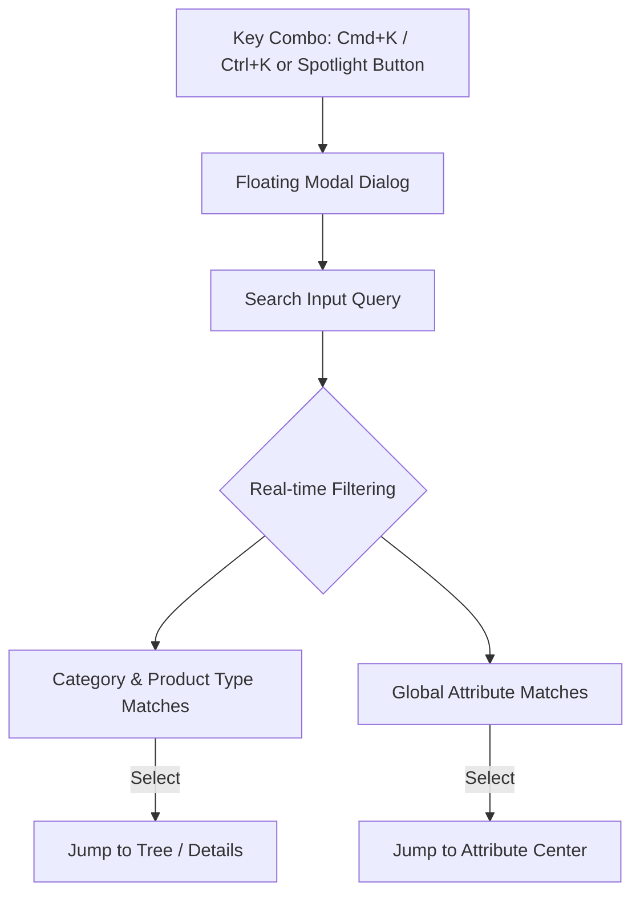

# Spotlight Command Palette (Cmd+K)

This guide documents the **Spotlight Command Palette** (`SpotlightPalette.tsx`), a universal keyboard-driven navigation tool powered by `cmdk`.

---

## 1. Triggering Spotlight Search

The command palette is accessible from any page within the application:

- **Mac Keyboard Shortcut**: <kbd>Cmd</kbd> + <kbd>K</kbd>
- **Windows / Linux Keyboard Shortcut**: <kbd>Ctrl</kbd> + <kbd>K</kbd>
- **Visual Button**: Click the search icon in the top navigation bar.

Pressing <kbd>Esc</kbd> or clicking outside the backdrop immediately dismisses the palette.

---

## 2. Omnisearch Capabilities

The palette indexes both **Taxonomy Nodes** and **Attribute Definitions**:

### 2.1 Group 1: التصنيفات والمنتجات (Categories & Products)
- Searches Arabic names, English names, and slugs across all four taxonomy tiers.
- Displays full breadcrumb context beneath each result (e.g., `الإلكترونيات / الهواتف المحمولة / هواتف ذكية`).
- Badges indicate whether the match is a `قسم`, `تصنيف`, `تصنيف فرعي`, or `نوع منتج`.

### 2.2 Group 2: مستودع الخصائص (Attribute Dictionary)
- Searches global attributes by name, English name, and programmatic key.
- Displays data type tags (`string`, `number`, `boolean`, `enum`) and assigned physical dimensions.

---

## 3. Keyboard Navigation & Actions

- **Arrow Down (<kbd>↓</kbd>) / Arrow Up (<kbd>↑</kbd>)**: Navigate between search matches.
- **Enter (<kbd>Enter</kbd>)**:
  - Selecting a **Taxonomy Node**: Navigates to `/categories/[id]`.
  - Selecting an **Attribute**: Navigates to `/attributes` and focuses the target definition.
