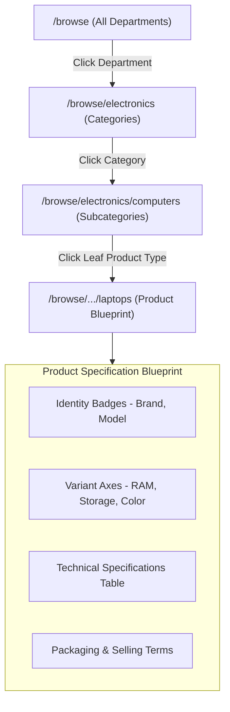

# Storefront Simulator & Product Specification Blueprint

This guide documents the **Storefront Simulator** (`/browse/[[...slug]]`), which allows catalog architects to experience the customer's visual navigation journey and inspect leaf **Product Specification Blueprints**.



---

## 1. Visual Navigation Journey (`/browse`)

The customer-facing simulation renders the catalog in modern, responsive visual cards:

### 1.1 Circular Visual Category Cards
- Each category card renders its uploaded image in a circular format, accompanied by the Arabic title, English subtitle, and a live counter of nested subcategories.
- Hover states include smooth elevation and micro-animations, mimicking a state-of-the-art e-commerce storefront.

### 1.2 Interactive Breadcrumb Trail
As you navigate deeper into the hierarchy, a sticky breadcrumb bar tracks your exact location:
```text
الرئيسية  >  الأجهزة الإلكترونية  >  أجهزة الحاسوب  >  حواسيب محمولة
```
- Clicking any ancestor chip navigates directly back to that level.
- URL paths update cleanly using canonical slugs: `/browse/electronics/computers/laptops`.

---

## 2. The Product Specification Blueprint

When reaching a leaf `product_type`, the storefront simulator transitions from category cards into the **Product Specification Blueprint** (`ProductBlueprint.tsx`).

The blueprint organizes bound attributes into distinct sections according to their **Strategic Roles**:

### 2.1 Identity Section (`Shield` Icon)
Displays the attributes required to identify and cluster the product:
- **Brand / الماركة**: Rendered with high visual prominence.
- **Model / الموديل**: Product line identifier.
- **Manufacturer Part Number (MPN)**: Factory reference key.

### 2.2 Variant Axes Section (`LayoutGrid` Icon)
Highlights the customer-selectable configuration axes:
- Every variant attribute displays an interactive badge (`مُتغير`).
- Allowed values are shown as selectable chips (e.g., `128 GB`, `256 GB`, `512 GB`).
- Associated measurement units (e.g., `GB`) are automatically appended to numeric values.

### 2.3 Technical Specifications Table (`Tags` Icon)
Structured table detailing all descriptive specifications:
- Name in Arabic and English.
- Target unit of measurement.
- Allowed values or free-text indicator (`نص حر / أي قيمة`).

### 2.4 Commercial & Logistics Section (`ShoppingCart` Icon)
Outlines wholesale units, case pack quantities, and minimum order thresholds.

---

## 3. Direct Authoring Shortcut

For maximum convenience, the top header of the Product Specification Blueprint features an administrative shortcut:
- **تعديل نوع المنتج (Edit Product Type)**: Opens `/categories/[id]` directly in a new tab, allowing immediate schema adjustments if a specification is missing or misconfigured.
