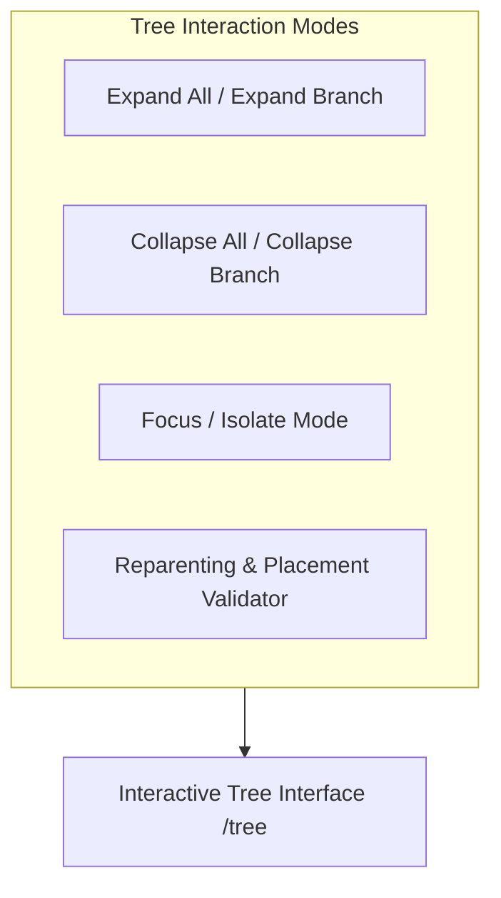

# Tree Management, Focus Mode & Reparenting Rules

This guide covers how to navigate, manipulate, and restructure the taxonomy tree using the **Tree Management View** (`/tree`).



---

## 1. Visual Taxonomy Tree Navigation

The `/tree` workspace provides a high-density, hierarchical view of your complete e-commerce catalog structure:

### 1.1 Branch Controls
- **Toggle Node**: Clicking the chevron next to any Department, Category, or Subcategory toggles its immediate children.
- **Global Actions**:
  - **توسيع الكل (Expand All)**: Unfolds all nested branches down to leaf Product Types.
  - **طي الكل (Collapse All)**: Collapses the tree back to root Departments.

### 1.2 Node Type Badges
Every node in the tree displays a distinct visual badge indicating its tier:
- `قسم رئيسي` (Department): Blue badge with an organizational icon.
- `تصنيف` (Category): Indigo badge.
- `تصنيف فرعي` (Subcategory): Cyan badge.
- `نوع منتج` (Product Type): Amber badge with an attribute counter tag (e.g., `5 خصائص`).

---

## 2. Focus / Isolate Mode

On large catalogs with thousands of nodes, scrolling through a deep hierarchy is overwhelming, especially on mobile devices or tablets.

**Focus Mode** allows you to isolate a specific subtree:
1. Hover over any Category or Subcategory.
2. Click the **عزل / تركيز (Focus)** icon button.
3. The view instantly hides all sibling branches, rendering the selected node as the temporary visual root.
4. An interactive breadcrumb banner appears at the top:
   ```text
   الوضع المركز: الإلكترونيات / الهواتف المحمولة  [ إلغاء وضع التركيز ✕ ]
   ```
5. Click **إلغاء وضع التركيز (Exit Focus Mode)** to restore the global tree view.

---

## 3. Reparenting & Changing Parent Nodes

To move a category or product type to a different parent:

### Step 3.1: Open the Reparenting Dialog
1. In the tree view or quick edit drawer, click **تغيير الأصل (Change Parent)**.
2. The modal displays a searchable selector of all eligible parent nodes.

### Step 3.2: Algorithmic Cycle Prevention
The selector applies the *Subtree Disqualification Algorithm* in real-time:
- **Self Disqualification**: The target node cannot be selected.
- **Current Parent Disqualification**: The existing parent is excluded.
- **Subtree Disqualification**: Every child, grandchild, and descendant of the target node is automatically removed from the list.

### Step 3.3: Strict Tier Placement Validation
The modal validates tier compatibility before submission:
- A `department` can only be set to `root` (`parent_id = null`).
- A `category` can only be placed under a `department`.
- A `subcategory` can only be placed under a `category`.
- A `product_type` can be placed under a `category` or `subcategory`.

Attempting an invalid placement immediately displays an Arabic feedback banner (e.g., *"لا يمكن نقل التصنيف إلى نفسه أو إلى أحد فروعه"*).

---

## 4. Deleting a Category Node

When clicking the **حذف (Delete)** action on any node:
1. **Child Protection**: If the node has active children, deletion is blocked with a modal warning:
   *"لا يمكن حذف «اسم التصنيف» لأنه يحتوي على X تصنيف فرعي. انقل التصنيفات الفرعية أو احذفها أولاً."*
2. **Schema Protection**: If a `product_type` has active attribute bindings, deletion is blocked until all bindings are detached.
3. **Safe Archival**: Empty nodes are safely transitioned to `status = 'archived'`.
